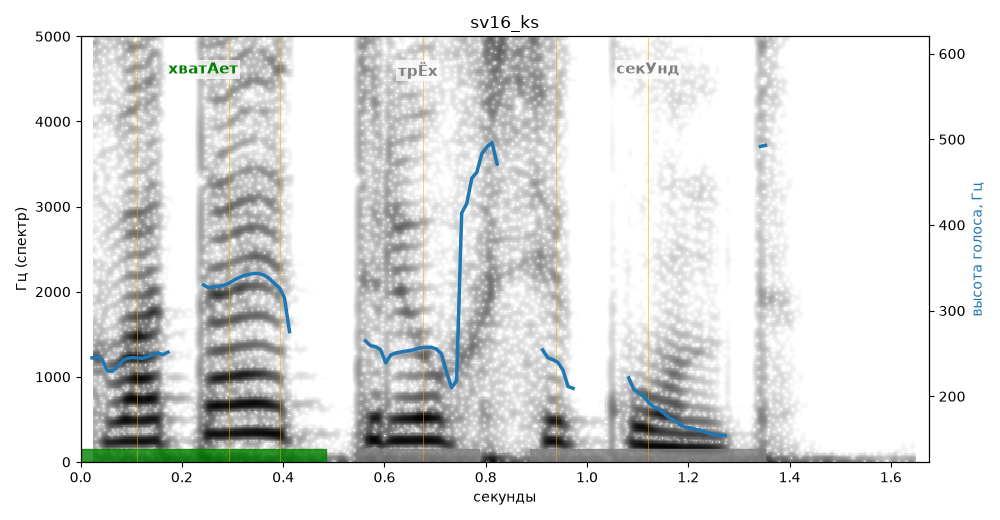

# sv16_ks

Голос: **silero:kseniya** · длительность 1.7 с
Естественность (UTMOS): **4.03 из 5** (живой диктор ≈ 4–4.5)
Эталон: Хватает трёх секунд.
Распознано: Охватает трех секунд.
Расхождения в словах: «хватает» → «охватает»

## Ударения
(где нужно: ruaccent)

| слово | нужно | у голоса | |
|---|---|---|---|
| хватает | хватАет | хватАет | ✓ |
| секунд | секУнд | сЕкунд | ? не разобрать |

## Интонация
- ✓ «хватает трёх секунд.» — конец фразы понижается — звучит законченно
- Диапазон голоса 19.0 полутонов (живо), средняя высота 249 Гц

## Паузы и темп
- паузы на своих местах
- Темп 4.4 слога/с (нормально)

_Синяя линия — высота голоса. Над словами заглавная буква — где ударение должно быть; красным — голос поставил не туда (уверенно), оранжевым — возможно._
