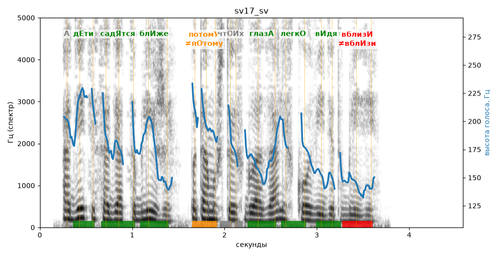

# sv17_sv

Голос: **edge:ru-RU-SvetlanaNeural** · длительность 4.6 с
Естественность (UTMOS): **3.71 из 5** (живой диктор ≈ 4–4.5)
Эталон: А дети садятся ближе, потому что их глаза легко видят вблизи.
Распознано: А дети садятся ближе, потому что их глаза легко видят вблизи.
Слова: все совпали

## Ударения
(где нужно: ruaccent)

| слово | нужно | у голоса | |
|---|---|---|---|
| дети | дЕти | дЕти | ✓ |
| садятся | садЯтся | садЯтся | ✓ |
| ближе | блИже | блИже | ✓ |
| потому | потомУ | пОтому | ✗? возможно — послушать |
| глаза | глазА | глазА | ✓ |
| легко | легкО | легкО | ✓ |
| видят | вИдят | вИдят | ✓ |
| вблизи | вблизИ | вблИзи | ✗ ОШИБКА |

## Интонация
- ✓ «а дети садятся ближе потому что их глаза легко видят вблизи.» — конец фразы понижается — звучит законченно
- Диапазон голоса 7.8 полутонов (живо), средняя высота 172 Гц

## Паузы и темп
- паузы на своих местах
- Темп 6.9 слога/с (быстро)

_Синяя линия — высота голоса. Над словами заглавная буква — где ударение должно быть; красным — голос поставил не туда (уверенно), оранжевым — возможно._
