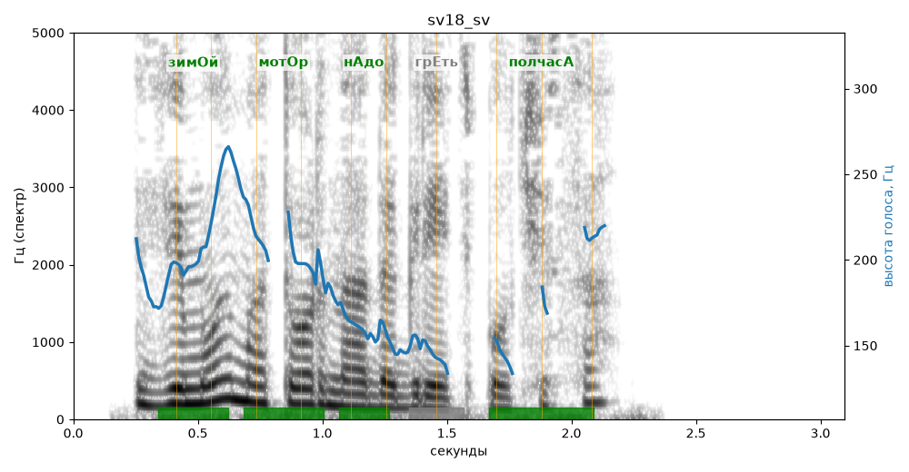

# sv18_sv

Голос: **edge:ru-RU-SvetlanaNeural** · длительность 3.1 с
Естественность (UTMOS): **3.78 из 5** (живой диктор ≈ 4–4.5)
Эталон: Зимой мотор надо греть полчаса?
Распознано: Зимой мотор надо греть полчаса.
Слова: все совпали

## Ударения
(где нужно: ruaccent)

| слово | нужно | у голоса | |
|---|---|---|---|
| зимой | зимОй | зимОй | ✓ |
| мотор | мотОр | мотОр | ✓ |
| надо | нАдо | нАдо | ✓ |
| полчаса | полчасА | полчасА | ✓ |

## Интонация
- ✗ «зимой мотор надо греть полчаса?» — нет вопросительного подъёма (самое высокое место — «зимой», в начале) — звучит как утверждение
- Диапазон голоса 9.6 полутонов (живо), средняя высота 186 Гц

## Паузы и темп
- паузы на своих местах
- Темп 5.7 слога/с (нормально)

_Синяя линия — высота голоса. Над словами заглавная буква — где ударение должно быть; красным — голос поставил не туда (уверенно), оранжевым — возможно._
