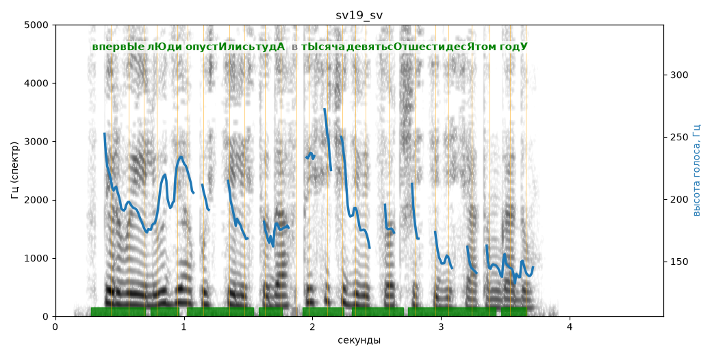

# sv19_sv

Голос: **edge:ru-RU-SvetlanaNeural** · длительность 4.7 с
Естественность (UTMOS): **3.62 из 5** (живой диктор ≈ 4–4.5)
Эталон: Впервые люди опустились туда в тысяча девятьсот шестидесятом году.
Распознано: Впервые люди опустились туда в 1960 году.
Расхождения в словах: «тысяча девятьсот шестидесятом» → «1960»

## Ударения
(где нужно: ruaccent)

| слово | нужно | у голоса | |
|---|---|---|---|
| впервые | впервЫе | впервЫе | ✓ |
| люди | лЮди | лЮди | ✓ |
| опустились | опустИлись | опустИлись | ✓ |
| туда | тудА | тудА | ✓ |
| тысяча | тЫсяча | тЫсяча | ✓ |
| девятьсот | девятьсОт | девятьсОт | ✓ |
| шестидесятом | шестидесЯтом | шестидесЯтом | ✓ |
| году | годУ | годУ | ✓ |

## Интонация
- ✓ «впервые люди опустились туда в тысяча девятьсот шестидесятом году.» — конец фразы понижается — звучит законченно
- Диапазон голоса 8.9 полутонов (живо), средняя высота 180 Гц

## Паузы и темп
- паузы на своих местах
- Темп 7.4 слога/с (быстро)

_Синяя линия — высота голоса. Над словами заглавная буква — где ударение должно быть; красным — голос поставил не туда (уверенно), оранжевым — возможно._
