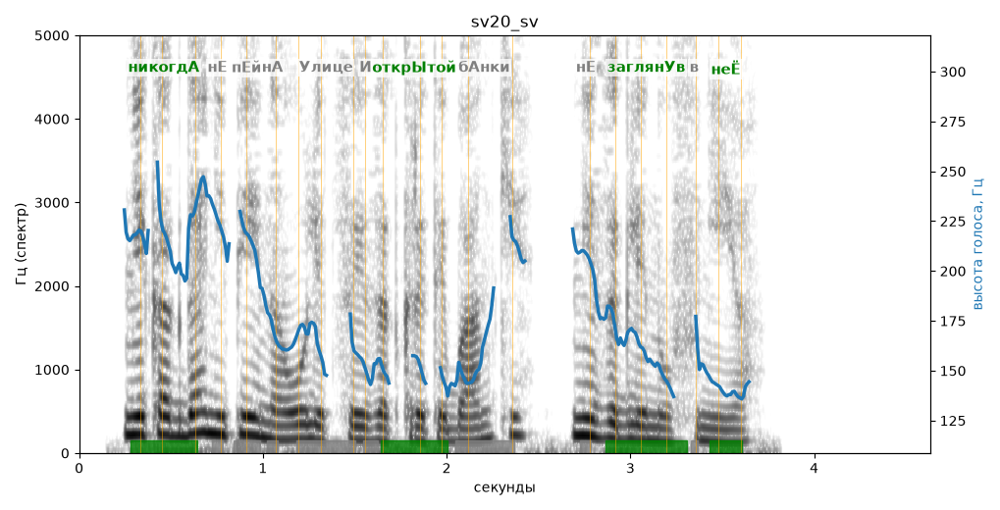

# sv20_sv

Голос: **edge:ru-RU-SvetlanaNeural** · длительность 4.6 с
Естественность (UTMOS): **4.02 из 5** (живой диктор ≈ 4–4.5)
Эталон: Никогда не пей на улице из открытой банки, не заглянув в неё.
Распознано: Никогда не пей на улице из открытой банки, не заглянув в нее.
Слова: все совпали

## Ударения
(где нужно: ruaccent)

| слово | нужно | у голоса | |
|---|---|---|---|
| никогда | никогдА | никогдА | ✓ |
| улице | Улице | улицЕ | ? не разобрать |
| открытой | открЫтой | открЫтой | ✓ |
| банки | бАнки | банкИ | ? не разобрать |
| заглянув | заглянУв | заглянУв | ✓ |
| неё | неЁ | неЁ | ✓ |

## Интонация
- ✓ «никогда не пей на улице из открытой банки не заглянув в неё.» — конец фразы понижается — звучит законченно
- Диапазон голоса 8.7 полутонов (живо), средняя высота 168 Гц

## Паузы и темп
- паузы на своих местах
- Темп 7.4 слога/с (быстро)

_Синяя линия — высота голоса. Над словами заглавная буква — где ударение должно быть; красным — голос поставил не туда (уверенно), оранжевым — возможно._
