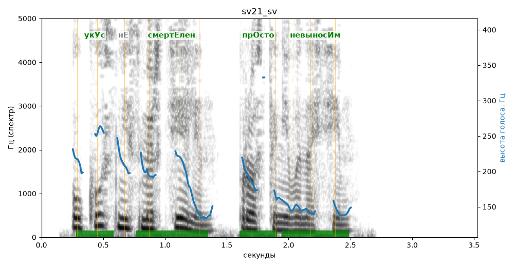

# sv21_sv

Голос: **edge:ru-RU-SvetlanaNeural** · длительность 3.5 с
Естественность (UTMOS): **3.82 из 5** (живой диктор ≈ 4–4.5)
Эталон: Укус не смертелен — просто невыносим.
Распознано: Укус не смертелен, просто не выносим.
Расхождения в словах: «невыносим» → «не выносим»

## Ударения
(где нужно: ruaccent)

| слово | нужно | у голоса | |
|---|---|---|---|
| укус | укУс | укУс | ✓ |
| смертелен | смертЕлен | смертЕлен | ✓ |
| просто | прОсто | прОсто | ✓ |
| невыносим | невыносИм | невыносИм | ✓ |

## Интонация
- ✓ «укус не смертелен просто невыносим.» — конец фразы понижается — звучит законченно
- Диапазон голоса 10.7 полутонов (живо), средняя высота 173 Гц

## Паузы и темп
- паузы на своих местах
- Темп 6.2 слога/с (нормально)

_Синяя линия — высота голоса. Над словами заглавная буква — где ударение должно быть; красным — голос поставил не туда (уверенно), оранжевым — возможно._
