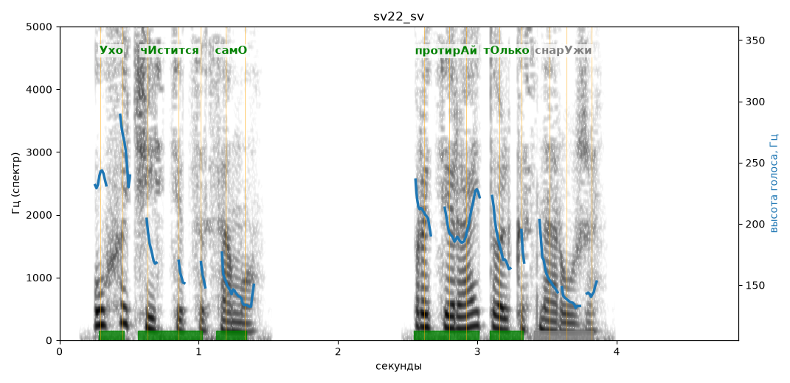

# sv22_sv

Голос: **edge:ru-RU-SvetlanaNeural** · длительность 4.9 с
Естественность (UTMOS): **3.84 из 5** (живой диктор ≈ 4–4.5)
Эталон: Ухо чистится само. Протирай только снаружи.
Распознано: Уха чистится само. Протирай только снаружи.
Расхождения в словах: «ухо» → «уха»

## Ударения
(где нужно: ruaccent)

| слово | нужно | у голоса | |
|---|---|---|---|
| ухо | Ухо | Ухо | ✓ |
| чистится | чИстится | чИстится | ✓ |
| само | самО | самО | ✓ |
| протирай | протирАй | протирАй | ✓ |
| только | тОлько | тОлько | ✓ |
| снаружи | снарУжи | снАружи | ? не разобрать |

## Интонация
- ✓ «ухо чистится само.» — конец фразы понижается — звучит законченно
- ✓ «протирай только снаружи.» — конец фразы понижается — звучит законченно
- Диапазон голоса 10.3 полутонов (живо), средняя высота 171 Гц

## Паузы и темп
- паузы на своих местах
- Темп 6.4 слога/с (нормально)

_Синяя линия — высота голоса. Над словами заглавная буква — где ударение должно быть; красным — голос поставил не туда (уверенно), оранжевым — возможно._
