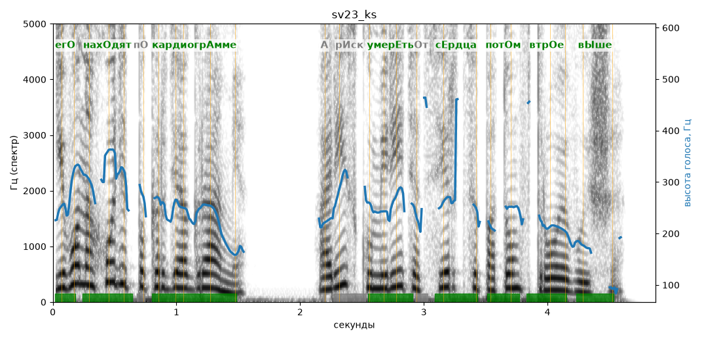

# sv23_ks

Голос: **silero:kseniya** · длительность 4.9 с
Естественность (UTMOS): **3.64 из 5** (живой диктор ≈ 4–4.5)
Эталон: Его находят по кардиограмме, а риск умереть от сердца потом втрое выше.
Распознано: Его находит по кардиограмме, а риск умереть от сердца потом в трое выше.
Расхождения в словах: «находят» → «находит»; «втрое» → «в трое»

## Ударения
(где нужно: ruaccent)

| слово | нужно | у голоса | |
|---|---|---|---|
| его | егО | егО | ✓ |
| находят | нахОдят | нахОдят | ✓ |
| кардиограмме | кардиогрАмме | кардиогрАмме | ✓ |
| умереть | умерЕть | умерЕть | ✓ |
| сердца | сЕрдца | сЕрдца | ✓ |
| потом | потОм | потОм | ✓ |
| втрое | втрОе | втрОе | ✓ |
| выше | вЫше | вЫше | ✓ |

## Интонация
- ✓ «его находят по кардиограмме а риск умереть от сердца потом втрое выше.» — конец фразы понижается — звучит законченно
- Диапазон голоса 13.2 полутонов (живо), средняя высота 248 Гц

## Паузы и темп
- паузы на своих местах
- Темп 6.6 слога/с (быстро)

_Синяя линия — высота голоса. Над словами заглавная буква — где ударение должно быть; красным — голос поставил не туда (уверенно), оранжевым — возможно._
