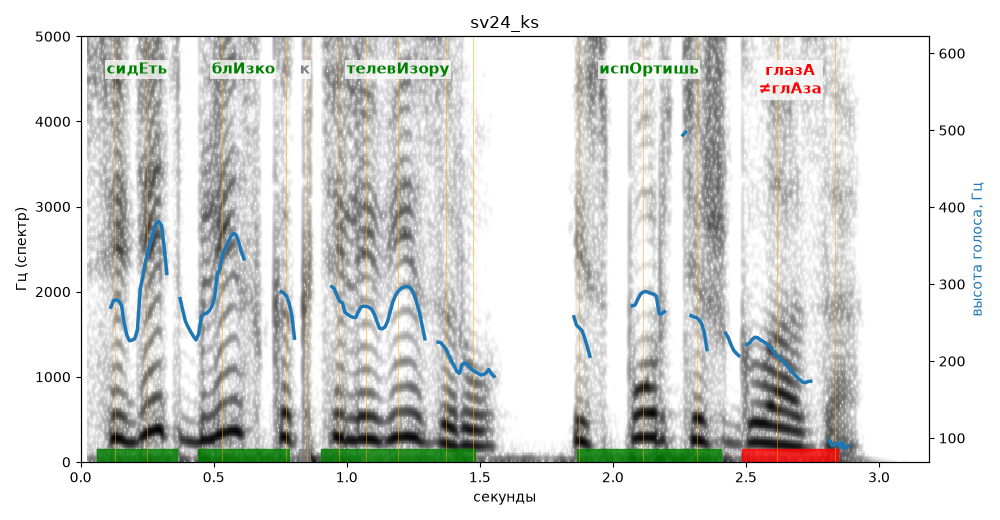

# sv24_ks

Голос: **silero:kseniya** · длительность 3.2 с
Естественность (UTMOS): **3.45 из 5** (живой диктор ≈ 4–4.5)
Эталон: Сидеть близко к телевизору — испортишь глаза?
Распознано: Сидеть близко к телевизору, испортишь глаза.
Слова: все совпали

## Ударения
(где нужно: ruaccent)

| слово | нужно | у голоса | |
|---|---|---|---|
| сидеть | сидЕть | сидЕть | ✓ |
| близко | блИзко | блИзко | ✓ |
| телевизору | телевИзору | телевИзору | ✓ |
| испортишь | испОртишь | испОртишь | ✓ |
| глаза | глазА | глАза | ✗ ОШИБКА |

## Интонация
- ✗ «сидеть близко к телевизору испортишь глаза?» — нет вопросительного подъёма (самое высокое место — «сидеть», в начале) — звучит как утверждение
- Диапазон голоса 12.6 полутонов (живо), средняя высота 252 Гц

## Паузы и темп
- паузы на своих местах
- Темп 6.2 слога/с (нормально)

_Синяя линия — высота голоса. Над словами заглавная буква — где ударение должно быть; красным — голос поставил не туда (уверенно), оранжевым — возможно._
