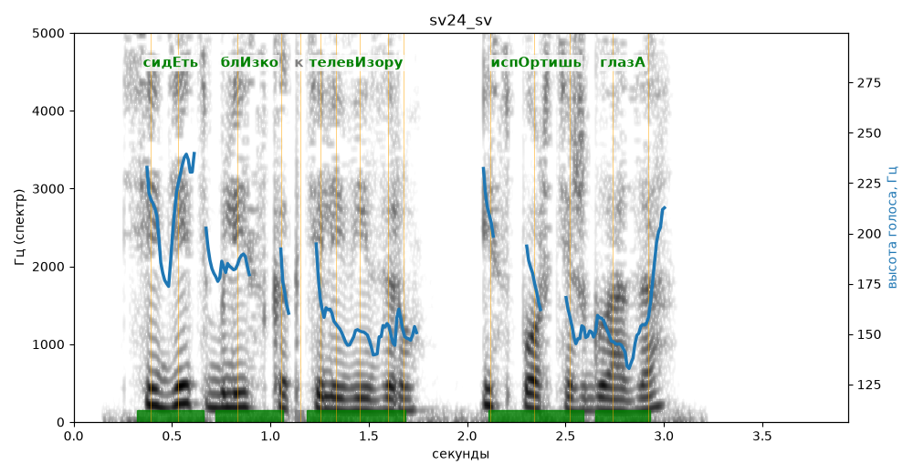

# sv24_sv

Голос: **edge:ru-RU-SvetlanaNeural** · длительность 3.9 с
Естественность (UTMOS): **3.82 из 5** (живой диктор ≈ 4–4.5)
Эталон: Сидеть близко к телевизору — испортишь глаза?
Распознано: Сидеть близко к телевизору и спортишь глаза.
Расхождения в словах: «испортишь» → «и спортишь»

## Ударения
(где нужно: ruaccent)

| слово | нужно | у голоса | |
|---|---|---|---|
| сидеть | сидЕть | сидЕть | ✓ |
| близко | блИзко | блИзко | ✓ |
| телевизору | телевИзору | телевИзору | ✓ |
| испортишь | испОртишь | испОртишь | ✓ |
| глаза | глазА | глазА | ✓ |

## Интонация
- ✗ «сидеть близко к телевизору испортишь глаза?» — нет вопросительного подъёма (самое высокое место — «сидеть», в начале) — звучит как утверждение
- Диапазон голоса 8.2 полутонов (живо), средняя высота 160 Гц

## Паузы и темп
- паузы на своих местах
- Темп 6.9 слога/с (быстро)

_Синяя линия — высота голоса. Над словами заглавная буква — где ударение должно быть; красным — голос поставил не туда (уверенно), оранжевым — возможно._
