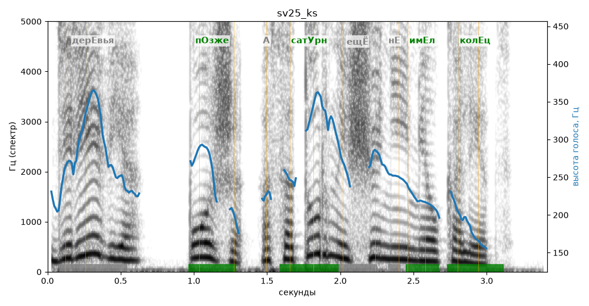

# sv25_ks

Голос: **silero:kseniya** · длительность 3.4 с
Естественность (UTMOS): **3.36 из 5** (живой диктор ≈ 4–4.5)
Эталон: Деревья — позже, а Сатурн ещё не имел колец.
Распознано: Деревья позже, а Сатурн еще не имел колец.
Слова: все совпали

## Ударения
(где нужно: ruaccent)

| слово | нужно | у голоса | |
|---|---|---|---|
| деревья | дерЕвья | — | ? |
| позже | пОзже | пОзже | ✓ |
| сатурн | сатУрн | сатУрн | ✓ |
| ещё | ещЁ | Ещё | ? не разобрать |
| имел | имЕл | имЕл | ✓ |
| колец | колЕц | колЕц | ✓ |

## Интонация
- ✓ «деревья позже а сатурн ещё не имел колец.» — конец фразы понижается — звучит законченно
- Диапазон голоса 12.0 полутонов (живо), средняя высота 252 Гц

## Паузы и темп
- паузы на своих местах
- Темп 5.8 слога/с (нормально)

_Синяя линия — высота голоса. Над словами заглавная буква — где ударение должно быть; красным — голос поставил не туда (уверенно), оранжевым — возможно._
