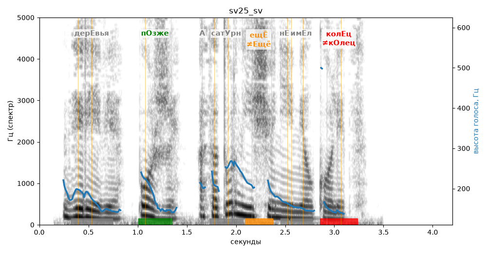

# sv25_sv

Голос: **edge:ru-RU-SvetlanaNeural** · длительность 4.2 с
Естественность (UTMOS): **3.61 из 5** (живой диктор ≈ 4–4.5)
Эталон: Деревья — позже, а Сатурн ещё не имел колец.
Распознано: Деревья, позже, а Сатурн еще не имел колец.
Слова: все совпали

## Ударения
(где нужно: ruaccent)

| слово | нужно | у голоса | |
|---|---|---|---|
| деревья | дерЕвья | — | ? |
| позже | пОзже | пОзже | ✓ |
| сатурн | сатУрн | сАтурн | ? не разобрать |
| ещё | ещЁ | Ещё | ✗? возможно — послушать |
| имел | имЕл | Имел | ? не разобрать |
| колец | колЕц | кОлец | ✗ ОШИБКА |

## Интонация
- ✓ «деревья позже а сатурн ещё не имел колец.» — конец фразы понижается — звучит законченно
- Диапазон голоса 10.3 полутонов (живо), средняя высота 170 Гц

## Паузы и темп
- паузы на своих местах
- Темп 6.0 слога/с (нормально)

_Синяя линия — высота голоса. Над словами заглавная буква — где ударение должно быть; красным — голос поставил не туда (уверенно), оранжевым — возможно._
