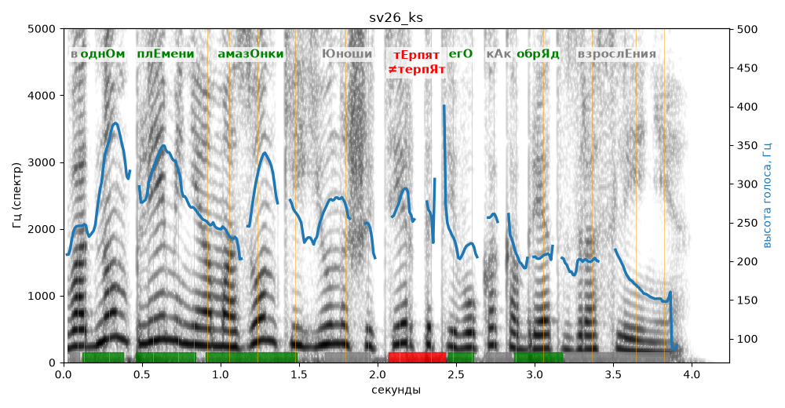

# sv26_ks

Голос: **silero:kseniya** · длительность 4.2 с
Естественность (UTMOS): **3.38 из 5** (живой диктор ≈ 4–4.5)
Эталон: В одном племени Амазонки юноши терпят его как обряд взросления.
Распознано: В одном племени Амазонки и юноши терпят его как обряд взросления.
Расхождения в словах: «» → «и»

## Ударения
(где нужно: ruaccent)

| слово | нужно | у голоса | |
|---|---|---|---|
| одном | однОм | однОм | ✓ |
| племени | плЕмени | плЕмени | ✓ |
| амазонки | амазОнки | амазОнки | ✓ |
| юноши | Юноши | — | ? |
| терпят | тЕрпят | терпЯт | ✗ ОШИБКА |
| его | егО | егО | ✓ |
| обряд | обрЯд | обрЯд | ✓ |
| взросления | взрослЕния | — | ? |

## Интонация
- ✓ «в одном племени амазонки юноши терпят его как обряд взросления.» — конец фразы понижается — звучит законченно
- Диапазон голоса 13.9 полутонов (живо), средняя высота 245 Гц

## Паузы и темп
- паузы на своих местах
- Темп 6.1 слога/с (нормально)

_Синяя линия — высота голоса. Над словами заглавная буква — где ударение должно быть; красным — голос поставил не туда (уверенно), оранжевым — возможно._
