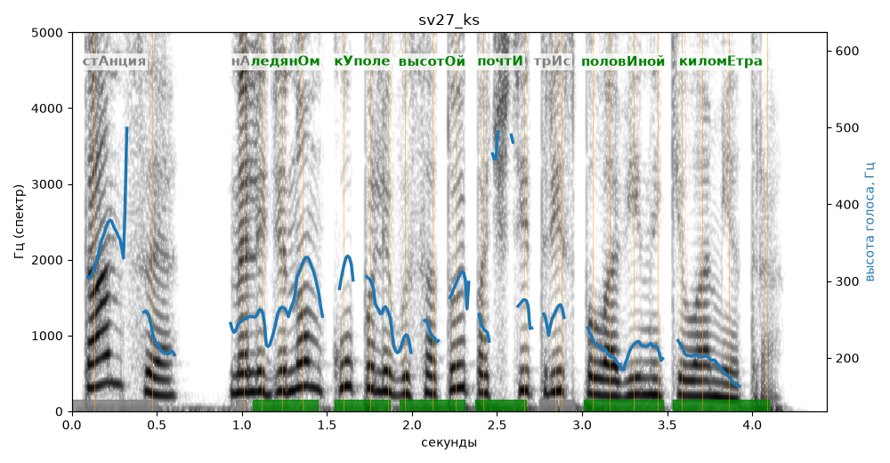

# sv27_ks

Голос: **silero:kseniya** · длительность 4.4 с
Естественность (UTMOS): **3.9 из 5** (живой диктор ≈ 4–4.5)
Эталон: Станция — на ледяном куполе высотой почти три с половиной километра.
Распознано: Станция на ледяном куполе высотой почти три с половиной километра.
Слова: все совпали

## Ударения
(где нужно: ruaccent)

| слово | нужно | у голоса | |
|---|---|---|---|
| станция | стАнция | — | ? |
| ледяном | ледянОм | ледянОм | ✓ |
| куполе | кУполе | кУполе | ✓ |
| высотой | высотОй | высотОй | ✓ |
| почти | почтИ | почтИ | ✓ |
| половиной | половИной | половИной | ✓ |
| километра | киломЕтра | киломЕтра | ✓ |

## Интонация
- ✓ «станция на ледяном куполе высотой почти три с половиной километра.» — конец фразы понижается — звучит законченно
- Диапазон голоса 11.5 полутонов (живо), средняя высота 244 Гц

## Паузы и темп
- паузы на своих местах
- Темп 6.6 слога/с (быстро)

_Синяя линия — высота голоса. Над словами заглавная буква — где ударение должно быть; красным — голос поставил не туда (уверенно), оранжевым — возможно._
