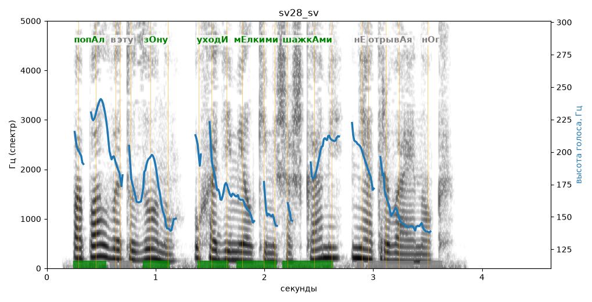

# sv28_sv

Голос: **edge:ru-RU-SvetlanaNeural** · длительность 4.6 с
Естественность (UTMOS): **3.98 из 5** (живой диктор ≈ 4–4.5)
Эталон: Попал в эту зону — уходи мелкими шажками, не отрывая ног.
Распознано: Попал в эту зону, уходи мелкими шашками, не отрывай ног.
Расхождения в словах: «шажками» → «шашками»; «отрывая» → «отрывай»

## Ударения
(где нужно: ruaccent)

| слово | нужно | у голоса | |
|---|---|---|---|
| попал | попАл | попАл | ✓ |
| эту | эту | этУ | нет эталона |
| зону | зОну | зОну | ✓ |
| уходи | уходИ | уходИ | ✓ |
| мелкими | мЕлкими | мЕлкими | ✓ |
| шажками | шажкАми | шажкАми | ✓ |
| отрывая | отрывАя | — | ? |

## Интонация
- ✓ «попал в эту зону уходи мелкими шажками не отрывая ног.» — конец фразы понижается — звучит законченно
- Диапазон голоса 8.1 полутонов (живо), средняя высота 174 Гц

## Паузы и темп
- паузы на своих местах
- Темп 7.2 слога/с (быстро)

_Синяя линия — высота голоса. Над словами заглавная буква — где ударение должно быть; красным — голос поставил не туда (уверенно), оранжевым — возможно._
