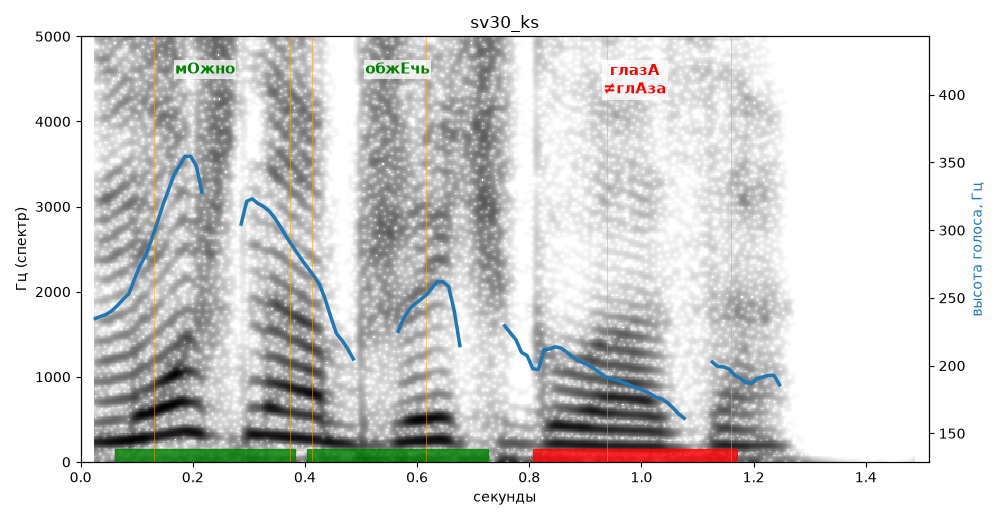

# sv30_ks

Голос: **silero:kseniya** · длительность 1.5 с
Естественность (UTMOS): **3.83 из 5** (живой диктор ≈ 4–4.5)
Эталон: Можно обжечь глаза.
Распознано: Можно обжечь глаза.
Слова: все совпали

## Ударения
(где нужно: ruaccent)

| слово | нужно | у голоса | |
|---|---|---|---|
| можно | мОжно | мОжно | ✓ |
| обжечь | обжЕчь | обжЕчь | ✓ |
| глаза | глазА | глАза | ✗ ОШИБКА |

## Интонация
- ✓ «можно обжечь глаза.» — конец фразы понижается — звучит законченно
- Диапазон голоса 10.9 полутонов (живо), средняя высота 224 Гц

## Паузы и темп
- паузы на своих местах
- Темп 5.4 слога/с (нормально)

_Синяя линия — высота голоса. Над словами заглавная буква — где ударение должно быть; красным — голос поставил не туда (уверенно), оранжевым — возможно._
