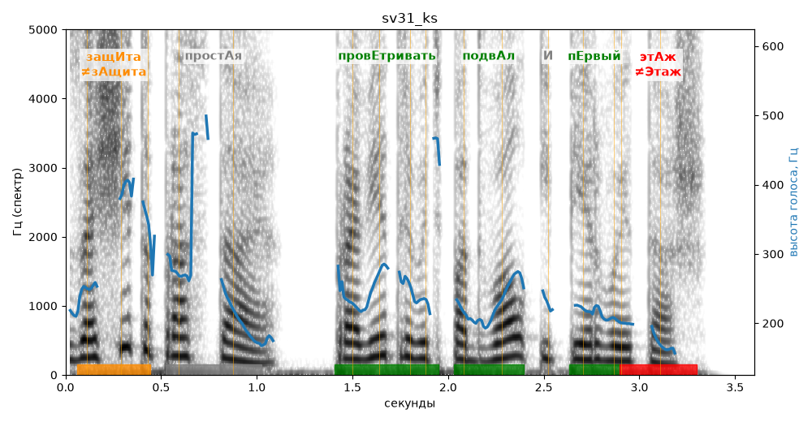

# sv31_ks

Голос: **silero:kseniya** · длительность 3.6 с
Естественность (UTMOS): **3.5 из 5** (живой диктор ≈ 4–4.5)
Эталон: Защита простая — проветривать подвал и первый этаж.
Распознано: Защита простая — проветривать подвал и первый этаж.
Слова: все совпали

## Ударения
(где нужно: ruaccent)

| слово | нужно | у голоса | |
|---|---|---|---|
| защита | защИта | зАщита | ✗? возможно — послушать |
| простая | простАя | — | ? |
| проветривать | провЕтривать | провЕтривать | ✓ |
| подвал | подвАл | подвАл | ✓ |
| первый | пЕрвый | пЕрвый | ✓ |
| этаж | этАж | Этаж | ✗ ОШИБКА |

## Интонация
- ✓ «защита простая проветривать подвал и первый этаж.» — конец фразы понижается — звучит законченно
- Диапазон голоса 15.0 полутонов (живо), средняя высота 228 Гц

## Паузы и темп
- паузы на своих местах
- Темп 5.6 слога/с (нормально)

_Синяя линия — высота голоса. Над словами заглавная буква — где ударение должно быть; красным — голос поставил не туда (уверенно), оранжевым — возможно._
