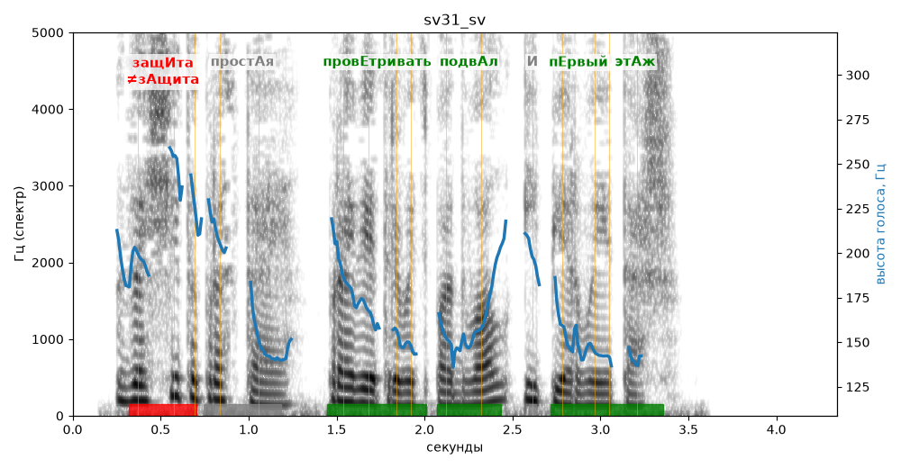

# sv31_sv

Голос: **edge:ru-RU-SvetlanaNeural** · длительность 4.3 с
Естественность (UTMOS): **3.77 из 5** (живой диктор ≈ 4–4.5)
Эталон: Защита простая — проветривать подвал и первый этаж.
Распознано: Защита простая, проветривать подвал и первый этаж.
Слова: все совпали

## Ударения
(где нужно: ruaccent)

| слово | нужно | у голоса | |
|---|---|---|---|
| защита | защИта | зАщита | ✗ ОШИБКА |
| простая | простАя | — | ? |
| проветривать | провЕтривать | провЕтривать | ✓ |
| подвал | подвАл | подвАл | ✓ |
| первый | пЕрвый | пЕрвый | ✓ |
| этаж | этАж | этАж | ✓ |

## Интонация
- ✓ «защита простая проветривать подвал и первый этаж.» — конец фразы понижается — звучит законченно
- Диапазон голоса 8.6 полутонов (живо), средняя высота 160 Гц

## Паузы и темп
- паузы на своих местах
- Темп 6.1 слога/с (нормально)

_Синяя линия — высота голоса. Над словами заглавная буква — где ударение должно быть; красным — голос поставил не туда (уверенно), оранжевым — возможно._
