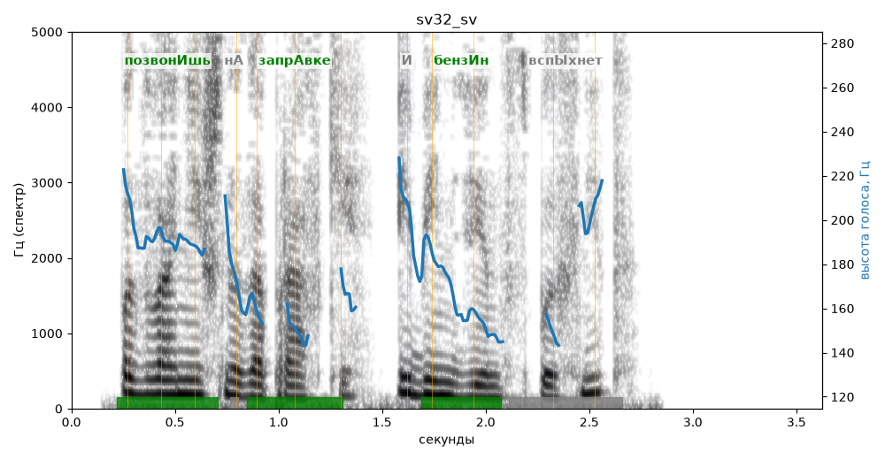

# sv32_sv

Голос: **edge:ru-RU-SvetlanaNeural** · длительность 3.6 с
Естественность (UTMOS): **3.95 из 5** (живой диктор ≈ 4–4.5)
Эталон: Позвонишь на заправке — и бензин вспыхнет?
Распознано: Позвонишь на заправки и бензин вспыхнет.
Расхождения в словах: «заправке» → «заправки»

## Ударения
(где нужно: ruaccent)

| слово | нужно | у голоса | |
|---|---|---|---|
| позвонишь | позвонИшь | позвонИшь | ✓ |
| заправке | запрАвке | запрАвке | ✓ |
| бензин | бензИн | бензИн | ✓ |
| вспыхнет | вспЫхнет | вспыхнЕт | ? не разобрать |

## Интонация
- ✗ «позвонишь на заправке и бензин вспыхнет?» — нет вопросительного подъёма (самое высокое место — «и», в начале) — звучит как утверждение
- Диапазон голоса 6.3 полутонов (нормально), средняя высота 179 Гц

## Паузы и темп
- паузы на своих местах
- Темп 5.6 слога/с (нормально)

_Синяя линия — высота голоса. Над словами заглавная буква — где ударение должно быть; красным — голос поставил не туда (уверенно), оранжевым — возможно._
