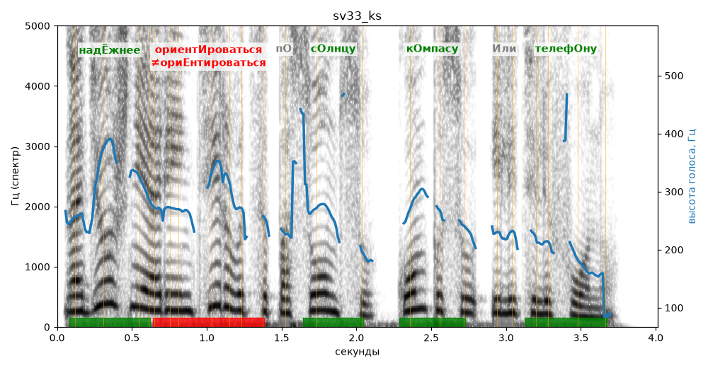

# sv33_ks

Голос: **silero:kseniya** · длительность 4.0 с
Естественность (UTMOS): **3.41 из 5** (живой диктор ≈ 4–4.5)
Эталон: Надёжнее ориентироваться по солнцу, компасу или телефону.
Распознано: Надёжнее ориентироваться по Солнцу, Компасу или Телефону.
Слова: все совпали

## Ударения
(где нужно: ruaccent)

| слово | нужно | у голоса | |
|---|---|---|---|
| надёжнее | надЁжнее | надЁжнее | ✓ |
| ориентироваться | ориентИроваться | ориЕнтироваться | ✗ ОШИБКА |
| солнцу | сОлнцу | сОлнцу | ✓ |
| компасу | кОмпасу | кОмпасу | ✓ |
| или | Или | илИ | ? не разобрать |
| телефону | телефОну | телефОну | ✓ |

## Интонация
- ✓ «надёжнее ориентироваться по солнцу компасу или телефону.» — конец фразы понижается — звучит законченно
- Диапазон голоса 14.9 полутонов (живо), средняя высота 261 Гц

## Паузы и темп
- паузы на своих местах
- Темп 7.3 слога/с (быстро)

_Синяя линия — высота голоса. Над словами заглавная буква — где ударение должно быть; красным — голос поставил не туда (уверенно), оранжевым — возможно._
