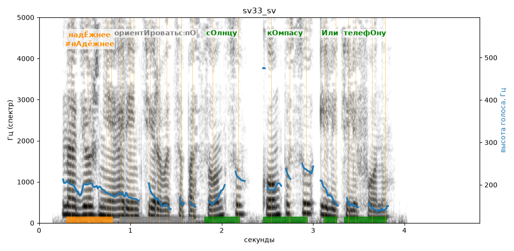

# sv33_sv

Голос: **edge:ru-RU-SvetlanaNeural** · длительность 4.8 с
Естественность (UTMOS): **3.82 из 5** (живой диктор ≈ 4–4.5)
Эталон: Надёжнее ориентироваться по солнцу, компасу или телефону.
Распознано: Надежнее ориентироваться по солнцу, компасу или телефону.
Слова: все совпали

## Ударения
(где нужно: ruaccent)

| слово | нужно | у голоса | |
|---|---|---|---|
| надёжнее | надЁжнее | нАдёжнее | ✗? возможно — послушать |
| ориентироваться | ориентИроваться | ориентирОваться | ? не разобрать |
| солнцу | сОлнцу | сОлнцу | ✓ |
| компасу | кОмпасу | кОмпасу | ✓ |
| или | Или | Или | ✓ |
| телефону | телефОну | телефОну | ✓ |

## Интонация
- ✓ «надёжнее ориентироваться по солнцу компасу или телефону.» — конец фразы понижается — звучит законченно
- Диапазон голоса 8.5 полутонов (живо), средняя высота 179 Гц

## Паузы и темп
- паузы на своих местах
- Темп 7.5 слога/с (быстро)

_Синяя линия — высота голоса. Над словами заглавная буква — где ударение должно быть; красным — голос поставил не туда (уверенно), оранжевым — возможно._
