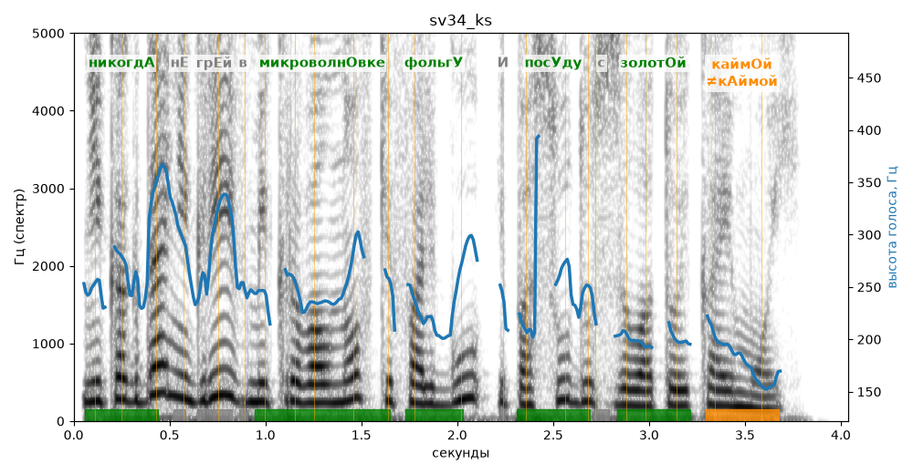

# sv34_ks

Голос: **silero:kseniya** · длительность 4.0 с
Естественность (UTMOS): **3.26 из 5** (живой диктор ≈ 4–4.5)
Эталон: Никогда не грей в микроволновке фольгу и посуду с золотой каймой.
Распознано: Никогда не грея в микроволновке фольгу и посуду с золотой каймой.
Расхождения в словах: «грей» → «грея»

## Ударения
(где нужно: ruaccent)

| слово | нужно | у голоса | |
|---|---|---|---|
| никогда | никогдА | никогдА | ✓ |
| микроволновке | микроволнОвке | микроволнОвке | ✓ |
| фольгу | фольгУ | фольгУ | ✓ |
| посуду | посУду | посУду | ✓ |
| золотой | золотОй | золотОй | ✓ |
| каймой | каймОй | кАймой | ✗? возможно — послушать |

## Интонация
- ✓ «никогда не грей в микроволновке фольгу и посуду с золотой каймой.» — конец фразы понижается — звучит законченно
- Диапазон голоса 11.7 полутонов (живо), средняя высота 239 Гц

## Паузы и темп
- паузы на своих местах
- Темп 6.7 слога/с (быстро)

_Синяя линия — высота голоса. Над словами заглавная буква — где ударение должно быть; красным — голос поставил не туда (уверенно), оранжевым — возможно._
