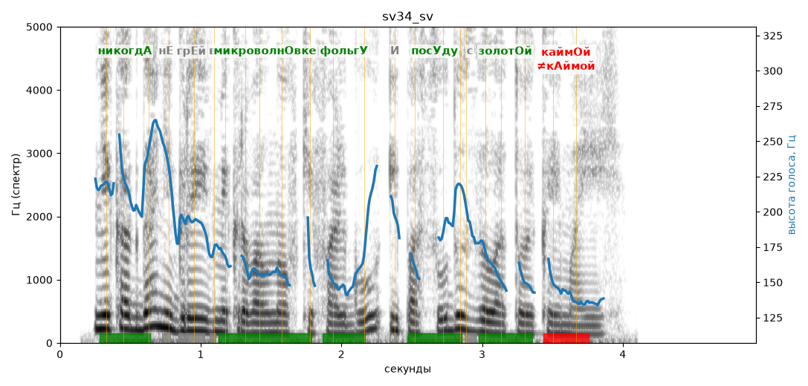

# sv34_sv

Голос: **edge:ru-RU-SvetlanaNeural** · длительность 4.9 с
Естественность (UTMOS): **3.74 из 5** (живой диктор ≈ 4–4.5)
Эталон: Никогда не грей в микроволновке фольгу и посуду с золотой каймой.
Распознано: Никогда не грей в микроволновке в альгу и по суду с золотойкой моей.
Расхождения в словах: «фольгу» → «в альгу»; «посуду» → «по суду»; «золотой каймой» → «золотойкой моей»

## Ударения
(где нужно: ruaccent)

| слово | нужно | у голоса | |
|---|---|---|---|
| никогда | никогдА | никогдА | ✓ |
| микроволновке | микроволнОвке | микроволнОвке | ✓ |
| фольгу | фольгУ | фольгУ | ✓ |
| посуду | посУду | посУду | ✓ |
| золотой | золотОй | золотОй | ✓ |
| каймой | каймОй | кАймой | ✗ ОШИБКА |

## Интонация
- ✓ «никогда не грей в микроволновке фольгу и посуду с золотой каймой.» — конец фразы понижается — звучит законченно
- Диапазон голоса 9.9 полутонов (живо), средняя высота 168 Гц

## Паузы и темп
- паузы на своих местах
- Темп 7.0 слога/с (быстро)

_Синяя линия — высота голоса. Над словами заглавная буква — где ударение должно быть; красным — голос поставил не туда (уверенно), оранжевым — возможно._
