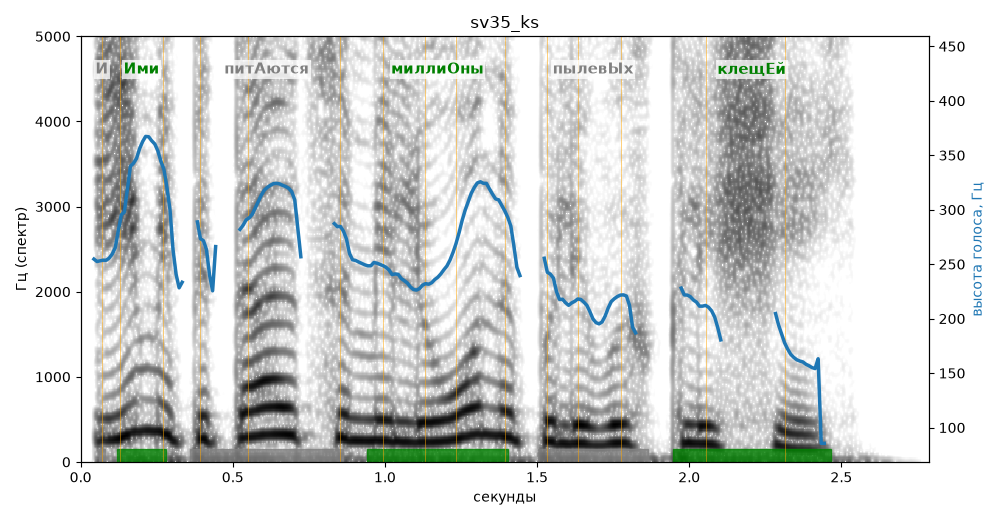

# sv35_ks

Голос: **silero:kseniya** · длительность 2.8 с
Естественность (UTMOS): **3.67 из 5** (живой диктор ≈ 4–4.5)
Эталон: И ими питаются миллионы пылевых клещей.
Распознано: Ими питаются миллионы полевых клещей.
Расхождения в словах: «и» → «»; «пылевых» → «полевых»

## Ударения
(где нужно: ruaccent)

| слово | нужно | у голоса | |
|---|---|---|---|
| ими | Ими | Ими | ✓ |
| питаются | питАются | — | ? |
| миллионы | миллиОны | миллиОны | ✓ |
| пылевых | пылевЫх | пЫлевых | ? не разобрать |
| клещей | клещЕй | клещЕй | ✓ |

## Интонация
- ✓ «и ими питаются миллионы пылевых клещей.» — конец фразы понижается — звучит законченно
- Диапазон голоса 12.8 полутонов (живо), средняя высота 249 Гц

## Паузы и темп
- паузы на своих местах
- Темп 6.2 слога/с (нормально)

_Синяя линия — высота голоса. Над словами заглавная буква — где ударение должно быть; красным — голос поставил не туда (уверенно), оранжевым — возможно._
