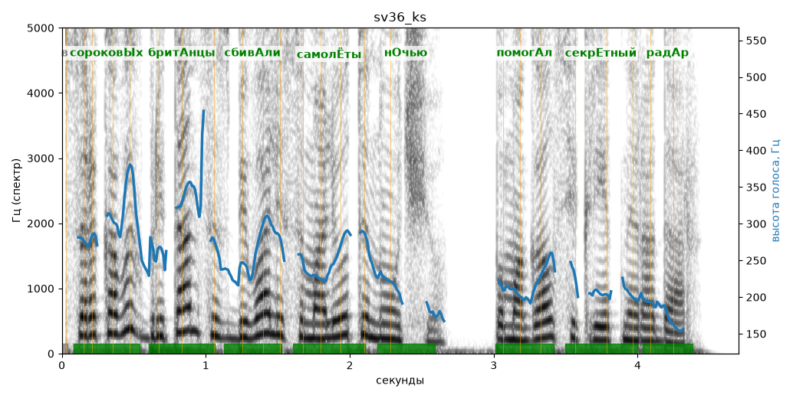

# sv36_ks

Голос: **silero:kseniya** · длительность 4.7 с
Естественность (UTMOS): **3.44 из 5** (живой диктор ≈ 4–4.5)
Эталон: В сороковых британцы сбивали самолёты ночью — помогал секретный радар.
Распознано: В 40-х британцы сбивали самолеты ночью, помогал секретный радар.
Расхождения в словах: «сороковых» → «40-х»

## Ударения
(где нужно: ruaccent)

| слово | нужно | у голоса | |
|---|---|---|---|
| сороковых | сороковЫх | сороковЫх | ✓ |
| британцы | бритАнцы | бритАнцы | ✓ |
| сбивали | сбивАли | сбивАли | ✓ |
| самолёты | самолЁты | самолЁты | ✓ |
| ночью | нОчью | нОчью | ✓ |
| помогал | помогАл | помогАл | ✓ |
| секретный | секрЕтный | секрЕтный | ✓ |
| радар | радАр | радАр | ✓ |

## Интонация
- ✓ «в сороковых британцы сбивали самолёты ночью помогал секретный радар.» — конец фразы понижается — звучит законченно
- Диапазон голоса 11.7 полутонов (живо), средняя высота 236 Гц

## Паузы и темп
- паузы на своих местах
- Темп 6.1 слога/с (нормально)

_Синяя линия — высота голоса. Над словами заглавная буква — где ударение должно быть; красным — голос поставил не туда (уверенно), оранжевым — возможно._
