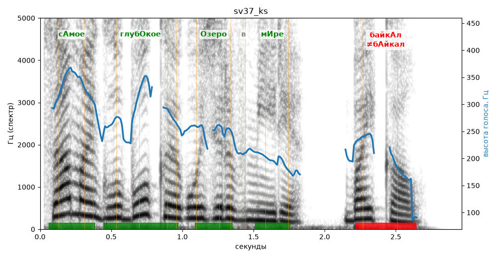

# sv37_ks

Голос: **silero:kseniya** · длительность 3.0 с
Естественность (UTMOS): **4.19 из 5** (живой диктор ≈ 4–4.5)
Эталон: Самое глубокое озеро в мире — Байкал.
Распознано: Самая глубокая озера в мире – Байкал.
Расхождения в словах: «самое глубокое озеро» → «самая глубокая озера»

## Ударения
(где нужно: ruaccent)

| слово | нужно | у голоса | |
|---|---|---|---|
| самое | сАмое | сАмое | ✓ |
| глубокое | глубОкое | глубОкое | ✓ |
| озеро | Озеро | Озеро | ✓ |
| мире | мИре | мИре | ✓ |
| байкал | байкАл | бАйкал | ✗ ОШИБКА |

## Интонация
- ✓ «самое глубокое озеро в мире байкал.» — конец фразы понижается — звучит законченно
- Диапазон голоса 12.7 полутонов (живо), средняя высота 245 Гц

## Паузы и темп
- паузы на своих местах
- Темп 7.1 слога/с (быстро)

_Синяя линия — высота голоса. Над словами заглавная буква — где ударение должно быть; красным — голос поставил не туда (уверенно), оранжевым — возможно._
