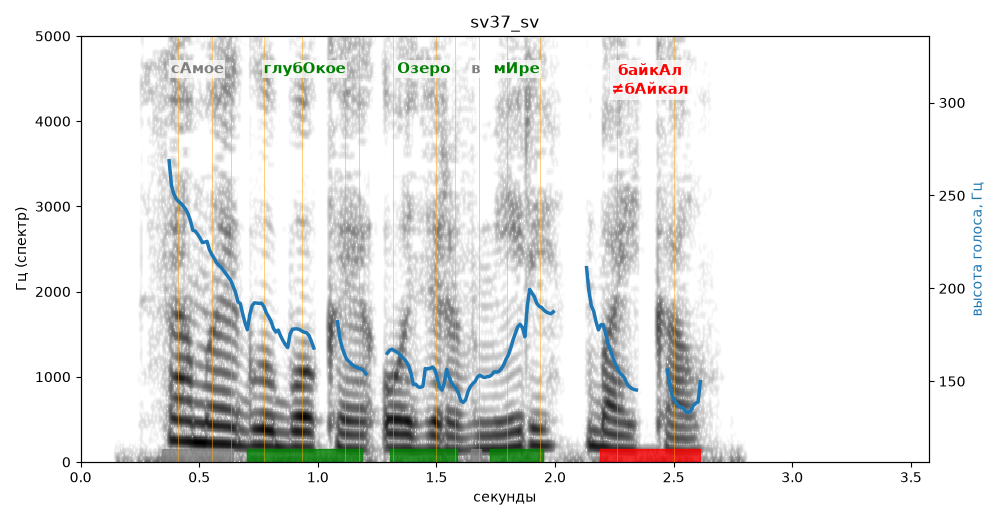

# sv37_sv

Голос: **edge:ru-RU-SvetlanaNeural** · длительность 3.6 с
Естественность (UTMOS): **4.06 из 5** (живой диктор ≈ 4–4.5)
Эталон: Самое глубокое озеро в мире — Байкал.
Распознано: Самое глубокое озеро в мире – Байкал.
Слова: все совпали

## Ударения
(где нужно: ruaccent)

| слово | нужно | у голоса | |
|---|---|---|---|
| самое | сАмое | самОе | ? не разобрать |
| глубокое | глубОкое | глубОкое | ✓ |
| озеро | Озеро | Озеро | ✓ |
| мире | мИре | мИре | ✓ |
| байкал | байкАл | бАйкал | ✗ ОШИБКА |

## Интонация
- ✓ «самое глубокое озеро в мире байкал.» — конец фразы понижается — звучит законченно
- Диапазон голоса 9.2 полутонов (живо), средняя высота 168 Гц

## Паузы и темп
- паузы на своих местах
- Темп 7.4 слога/с (быстро)

_Синяя линия — высота голоса. Над словами заглавная буква — где ударение должно быть; красным — голос поставил не туда (уверенно), оранжевым — возможно._
