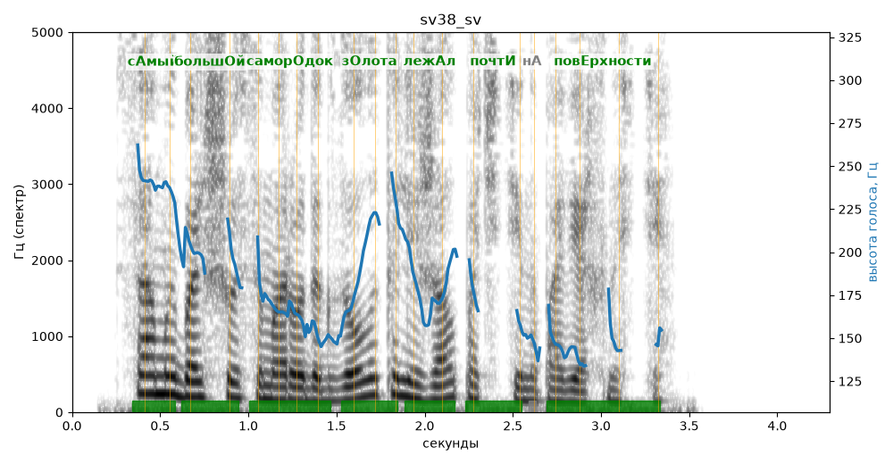

# sv38_sv

Голос: **edge:ru-RU-SvetlanaNeural** · длительность 4.3 с
Естественность (UTMOS): **3.73 из 5** (живой диктор ≈ 4–4.5)
Эталон: Самый большой самородок золота лежал почти на поверхности.
Распознано: Самый большой самородок золота лежал почти на поверхности.
Слова: все совпали

## Ударения
(где нужно: ruaccent)

| слово | нужно | у голоса | |
|---|---|---|---|
| самый | сАмый | сАмый | ✓ |
| большой | большОй | большОй | ✓ |
| самородок | саморОдок | саморОдок | ✓ |
| золота | зОлота | зОлота | ✓ |
| лежал | лежАл | лежАл | ✓ |
| почти | почтИ | почтИ | ✓ |
| поверхности | повЕрхности | повЕрхности | ✓ |

## Интонация
- ✓ «самый большой самородок золота лежал почти на поверхности.» — конец фразы понижается — звучит законченно
- Диапазон голоса 9.1 полутонов (живо), средняя высота 172 Гц

## Паузы и темп
- паузы на своих местах
- Темп 6.7 слога/с (быстро)

_Синяя линия — высота голоса. Над словами заглавная буква — где ударение должно быть; красным — голос поставил не туда (уверенно), оранжевым — возможно._
