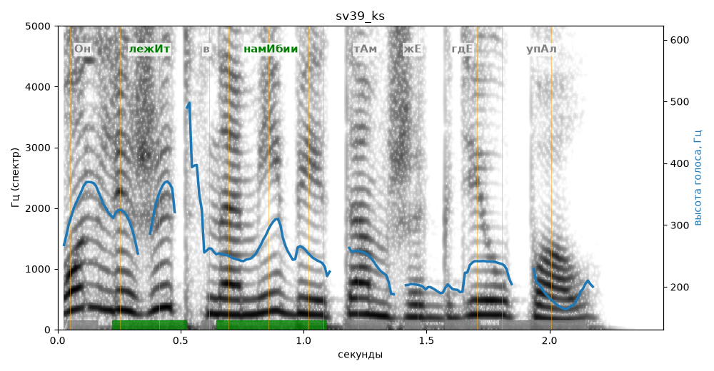

# sv39_ks

Голос: **silero:kseniya** · длительность 2.5 с
Естественность (UTMOS): **3.24 из 5** (живой диктор ≈ 4–4.5)
Эталон: Он лежит в Намибии там же, где упал.
Распознано: Он лежит в намибии там же, где упал.
Слова: все совпали

## Ударения
(где нужно: ruaccent)

| слово | нужно | у голоса | |
|---|---|---|---|
| лежит | лежИт | лежИт | ✓ |
| намибии | намИбии | намИбии | ✓ |
| упал | упАл | Упал | ? не разобрать |

## Интонация
- ✓ «он лежит в намибии там же где упал.» — конец фразы понижается — звучит законченно
- Диапазон голоса 12.7 полутонов (живо), средняя высота 246 Гц

## Паузы и темп
- паузы на своих местах
- Темп 6.2 слога/с (нормально)

_Синяя линия — высота голоса. Над словами заглавная буква — где ударение должно быть; красным — голос поставил не туда (уверенно), оранжевым — возможно._
