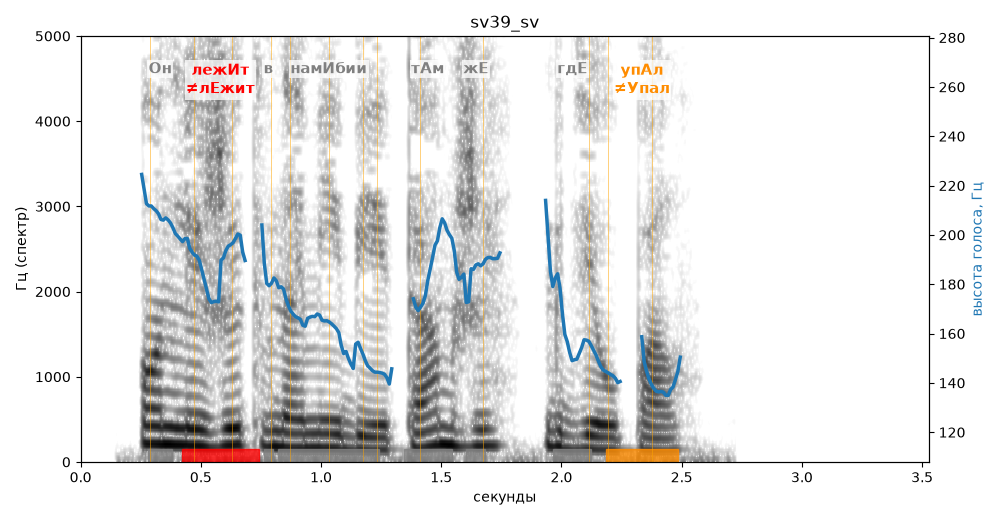

# sv39_sv

Голос: **edge:ru-RU-SvetlanaNeural** · длительность 3.5 с
Естественность (UTMOS): **3.53 из 5** (живой диктор ≈ 4–4.5)
Эталон: Он лежит в Намибии там же, где упал.
Распознано: Он лежит в намебии там же, где упал.
Расхождения в словах: «намибии» → «намебии»

## Ударения
(где нужно: ruaccent)

| слово | нужно | у голоса | |
|---|---|---|---|
| лежит | лежИт | лЕжит | ✗ ОШИБКА |
| намибии | намИбии | нАмибии | ? не разобрать |
| упал | упАл | Упал | ✗? возможно — послушать |

## Интонация
- ✓ «он лежит в намибии там же где упал.» — конец фразы понижается — звучит законченно
- Диапазон голоса 6.8 полутонов (нормально), средняя высота 173 Гц

## Паузы и темп
- паузы на своих местах
- Темп 6.8 слога/с (быстро)

_Синяя линия — высота голоса. Над словами заглавная буква — где ударение должно быть; красным — голос поставил не туда (уверенно), оранжевым — возможно._
