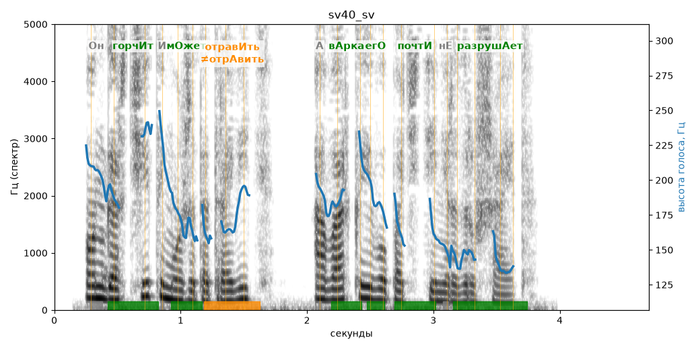

# sv40_sv

Голос: **edge:ru-RU-SvetlanaNeural** · длительность 4.7 с
Естественность (UTMOS): **3.61 из 5** (живой диктор ≈ 4–4.5)
Эталон: Он горчит и может отравить, а варка его почти не разрушает.
Распознано: Он горчит и может отравить, а варка его почти не разрушает.
Слова: все совпали

## Ударения
(где нужно: ruaccent)

| слово | нужно | у голоса | |
|---|---|---|---|
| горчит | горчИт | горчИт | ✓ |
| может | мОжет | мОжет | ✓ |
| отравить | отравИть | отрАвить | ✗? возможно — послушать |
| варка | вАрка | вАрка | ✓ |
| его | егО | егО | ✓ |
| почти | почтИ | почтИ | ✓ |
| разрушает | разрушАет | разрушАет | ✓ |

## Интонация
- ✓ «он горчит и может отравить а варка его почти не разрушает.» — конец фразы понижается — звучит законченно
- Диапазон голоса 9.1 полутонов (живо), средняя высота 177 Гц

## Паузы и темп
- паузы на своих местах
- Темп 7.0 слога/с (быстро)

_Синяя линия — высота голоса. Над словами заглавная буква — где ударение должно быть; красным — голос поставил не туда (уверенно), оранжевым — возможно._
