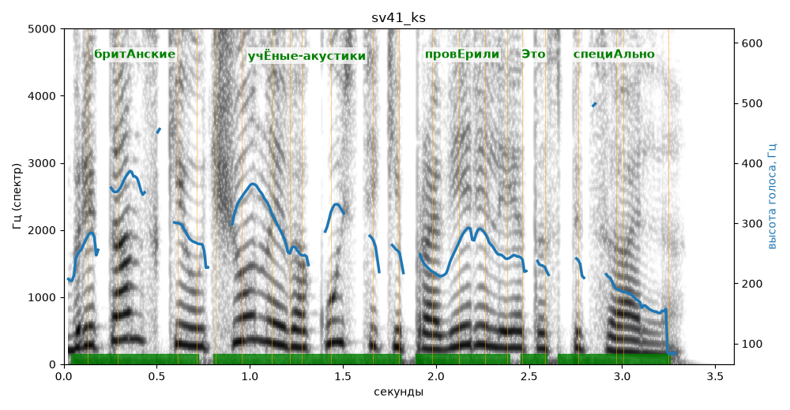

# sv41_ks

Голос: **silero:kseniya** · длительность 3.6 с
Естественность (UTMOS): **3.9 из 5** (живой диктор ≈ 4–4.5)
Эталон: Британские учёные-акустики проверили это специально.
Распознано: Британские ученые в акустике проверили это специально.
Расхождения в словах: «ученые-акустики» → «ученые в акустике»

## Ударения
(где нужно: ruaccent)

| слово | нужно | у голоса | |
|---|---|---|---|
| британские | бритАнские | бритАнские | ✓ |
| учёные-акустики | учЁные-акустики | учЁные-акустики | ✓ |
| проверили | провЕрили | провЕрили | ✓ |
| это | Это | Это | ✓ |
| специально | специАльно | специАльно | ✓ |

## Интонация
- ✓ «британские учёные-акустики проверили это специально.» — конец фразы понижается — звучит законченно
- Диапазон голоса 15.0 полутонов (живо), средняя высота 257 Гц

## Паузы и темп
- паузы на своих местах
- Темп 6.8 слога/с (быстро)

_Синяя линия — высота голоса. Над словами заглавная буква — где ударение должно быть; красным — голос поставил не туда (уверенно), оранжевым — возможно._
