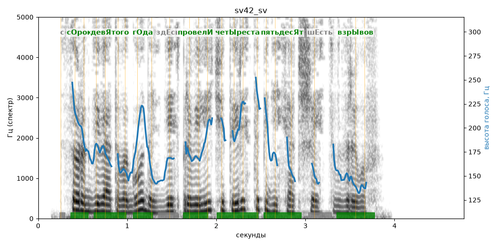

# sv42_sv

Голос: **edge:ru-RU-SvetlanaNeural** · длительность 4.8 с
Естественность (UTMOS): **3.45 из 5** (живой диктор ≈ 4–4.5)
Эталон: С сорок девятого года здесь провели четыреста пятьдесят шесть взрывов.
Распознано: 49 года здесь провели 456 взрывов.
Расхождения в словах: «с сорок девятого» → «49»; «четыреста пятьдесят шесть» → «456»

## Ударения
(где нужно: ruaccent)

| слово | нужно | у голоса | |
|---|---|---|---|
| сорок | сОрок | сОрок | ✓ |
| девятого | девЯтого | девЯтого | ✓ |
| года | гОда | гОда | ✓ |
| провели | провелИ | провелИ | ✓ |
| четыреста | четЫреста | четЫреста | ✓ |
| пятьдесят | пятьдесЯт | пятьдесЯт | ✓ |
| взрывов | взрЫвов | взрЫвов | ✓ |

## Интонация
- ✓ «с сорок девятого года здесь провели четыреста пятьдесят шесть взрывов.» — конец фразы понижается — звучит законченно
- Диапазон голоса 8.1 полутонов (живо), средняя высота 169 Гц

## Паузы и темп
- паузы на своих местах
- Темп 6.5 слога/с (нормально)

_Синяя линия — высота голоса. Над словами заглавная буква — где ударение должно быть; красным — голос поставил не туда (уверенно), оранжевым — возможно._
