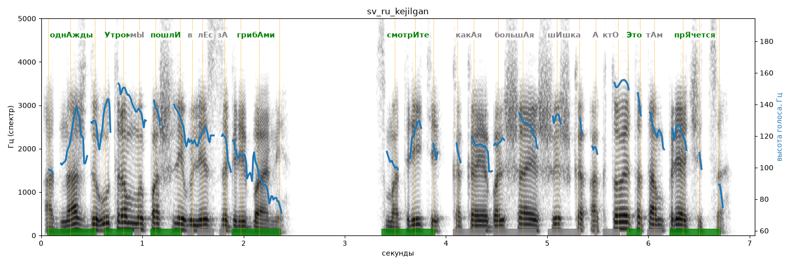

# sv_ru_kejilgan

Голос: **ru_kejilgan** · длительность 7.0 с
Естественность (UTMOS): **3.21 из 5** (живой диктор ≈ 4–4.5)
Эталон: Однажды утром мы пошли в лес за грибами. Смотрите, какая большая шишка! А кто это там прячется?
Распознано: Однажды утром мы пошли в лес за грибами. Смотрите, какая большая шишка, а кто это там прячется?
Слова: все совпали

## Ударения
(где нужно: ruaccent)

| слово | нужно | у голоса | |
|---|---|---|---|
| однажды | однАжды | однАжды | ✓ |
| утром | Утром | Утром | ✓ |
| пошли | пошлИ | пошлИ | ✓ |
| грибами | грибАми | грибАми | ✓ |
| смотрите | смотрИте | смотрИте | ✓ |
| какая | какАя | — | ? |
| большая | большАя | — | ? |
| шишка | шИшка | шишкА | ? не разобрать |
| это | Это | Это | ✓ |
| прячется | прЯчется | прЯчется | ✓ |

## Интонация
- ✓ «однажды утром мы пошли в лес за грибами.» — конец фразы понижается — звучит законченно
- ✓ «смотрите какая большая шишка!» — выделено слово «шишка» (+2.5 пт)
- ✗ «а кто это там прячется?» — нет вопросительного подъёма (самое высокое место — «это», в начале) — звучит как утверждение
- Диапазон голоса 9.5 полутонов (живо), средняя высота 119 Гц

## Паузы и темп
- после «шишка!» пауза всего 0.14 с — фразы слипаются
- Темп 5.7 слога/с (нормально)

_Синяя линия — высота голоса. Над словами заглавная буква — где ударение должно быть; красным — голос поставил не туда (уверенно), оранжевым — возможно._
