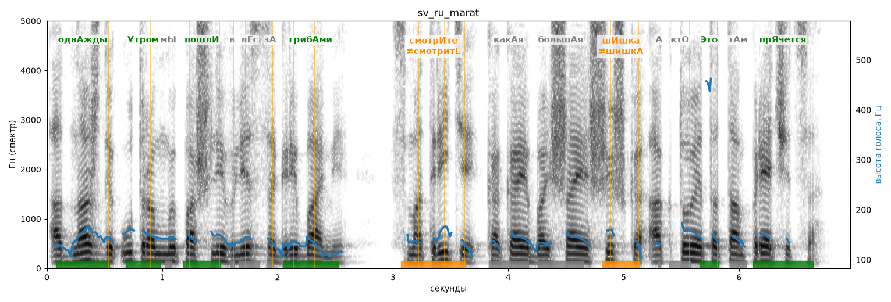

# sv_ru_marat

Голос: **ru_marat** · длительность 7.0 с
Естественность (UTMOS): **3.33 из 5** (живой диктор ≈ 4–4.5)
Эталон: Однажды утром мы пошли в лес за грибами. Смотрите, какая большая шишка! А кто это там прячется?
Распознано: Однажды утром мы пошли в лес с огрибами. Смотрите, какая большая шишка, а кто это там прячется.
Расхождения в словах: «за грибами» → «с огрибами»

## Ударения
(где нужно: ruaccent)

| слово | нужно | у голоса | |
|---|---|---|---|
| однажды | однАжды | однАжды | ✓ |
| утром | Утром | Утром | ✓ |
| пошли | пошлИ | пошлИ | ✓ |
| грибами | грибАми | грибАми | ✓ |
| смотрите | смотрИте | смотритЕ | ✗? возможно — послушать |
| какая | какАя | — | ? |
| большая | большАя | — | ? |
| шишка | шИшка | шишкА | ✗? возможно — послушать |
| это | Это | Это | ✓ |
| прячется | прЯчется | прЯчется | ✓ |

## Интонация
- ✓ «однажды утром мы пошли в лес за грибами.» — конец фразы понижается — звучит законченно
- ✓ «смотрите какая большая шишка!» — выделено слово «шишка» (+2.8 пт)
- ✗ «а кто это там прячется?» — нет вопросительного подъёма (самое высокое место — «кто», в начале) — звучит как утверждение
- Диапазон голоса 6.3 полутонов (нормально), средняя высота 141 Гц

## Паузы и темп
- после «шишка!» пауза всего 0.16 с — фразы слипаются
- Темп 5.6 слога/с (нормально)

_Синяя линия — высота голоса. Над словами заглавная буква — где ударение должно быть; красным — голос поставил не туда (уверенно), оранжевым — возможно._
