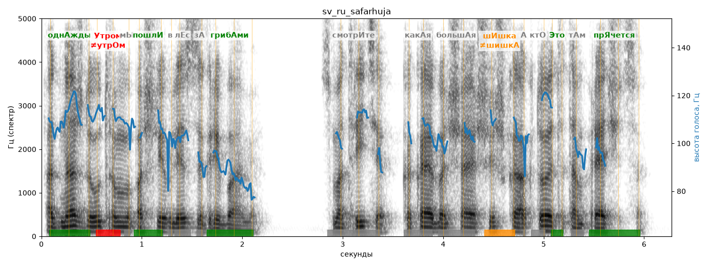

# sv_ru_safarhuja

Голос: **ru_safarhuja** · длительность 6.3 с
Естественность (UTMOS): **3.09 из 5** (живой диктор ≈ 4–4.5)
Эталон: Однажды утром мы пошли в лес за грибами. Смотрите, какая большая шишка! А кто это там прячется?
Распознано: Однажды утром мы пошли в лес за грибами. Смотрите, какая большая шишка, а кто это там прячется?
Слова: все совпали

## Ударения
(где нужно: ruaccent)

| слово | нужно | у голоса | |
|---|---|---|---|
| однажды | однАжды | однАжды | ✓ |
| утром | Утром | утрОм | ✗ ОШИБКА |
| пошли | пошлИ | пошлИ | ✓ |
| грибами | грибАми | грибАми | ✓ |
| смотрите | смотрИте | смотритЕ | ? не разобрать |
| какая | какАя | — | ? |
| большая | большАя | — | ? |
| шишка | шИшка | шишкА | ✗? возможно — послушать |
| это | Это | Это | ✓ |
| прячется | прЯчется | прЯчется | ✓ |

## Интонация
- ✓ «однажды утром мы пошли в лес за грибами.» — конец фразы понижается — звучит законченно
- ✗ «смотрите какая большая шишка!» — восклицание звучит ровно, без эмоции
- ✓ «а кто это там прячется?» — вопросительный подъём на слове «кто»
- Диапазон голоса 5.8 полутонов (нормально), средняя высота 103 Гц

## Паузы и темп
- после «шишка!» пауза всего 0.08 с — фразы слипаются
- Темп 6.3 слога/с (нормально)

_Синяя линия — высота голоса. Над словами заглавная буква — где ударение должно быть; красным — голос поставил не туда (уверенно), оранжевым — возможно._
