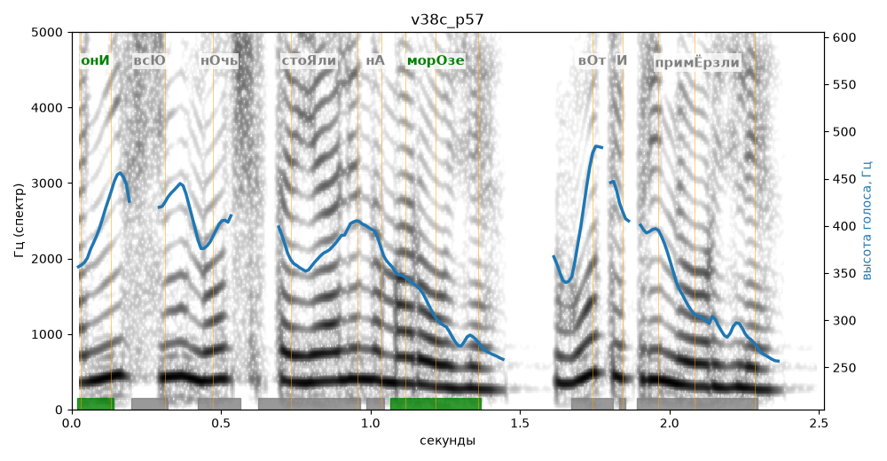

# v38c_p57

Естественность (UTMOS): **1.45 из 5** (живой диктор ≈ 4–4.5)
Эталон: Они всю ночь стояли на морозе. Вот и примёрзли.
Распознано: Они всю ночь стояли на морозе. Вот и примёрзли.
Слова: все совпали

## Ударения
(где нужно: ruaccent)

| слово | нужно | у голоса | |
|---|---|---|---|
| они | онИ | онИ | ✓ |
| стояли | стоЯли | — | ? |
| морозе | морОзе | морОзе | ✓ |
| примёрзли | примЁрзли | примёрзлИ | ? не разобрать |

## Интонация
- ✓ «они всю ночь стояли на морозе.» — конец фразы понижается — звучит законченно
- ✓ «вот и примёрзли.» — конец фразы понижается — звучит законченно
- Диапазон голоса 9.1 полутонов (живо), средняя высота 364 Гц

## Паузы и темп
- паузы на своих местах
- Темп 7.6 слога/с (быстро)

_Синяя линия — высота голоса. Над словами заглавная буква — где ударение должно быть; красным — голос поставил не туда (уверенно), оранжевым — возможно._
