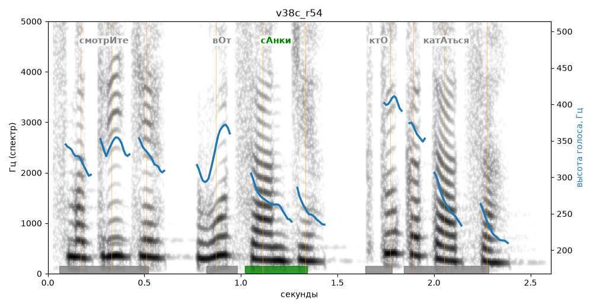

# v38c_r54

Естественность (UTMOS): **2.41 из 5** (живой диктор ≈ 4–4.5)
Эталон: Смотрите, вот санки! Кто кататься?
Распознано: Смотрите, вот Санде, кто кататься!
Расхождения в словах: «санки» → «санде»

## Ударения
(где нужно: ruaccent)

| слово | нужно | у голоса | |
|---|---|---|---|
| смотрите | смотрИте | смотритЕ | ? не разобрать |
| санки | сАнки | сАнки | ✓ |
| кататься | катАться | кататьсЯ | ? не разобрать |

## Интонация
- ✗ «смотрите вот санки!» — восклицание звучит ровно, без эмоции
- ✓ «кто кататься?» — конец фразы понижается — звучит законченно
- Диапазон голоса 10.1 полутонов (живо), средняя высота 306 Гц

## Паузы и темп
- паузы на своих местах
- Темп 6.2 слога/с (нормально)

_Синяя линия — высота голоса. Над словами заглавная буква — где ударение должно быть; красным — голос поставил не туда (уверенно), оранжевым — возможно._
