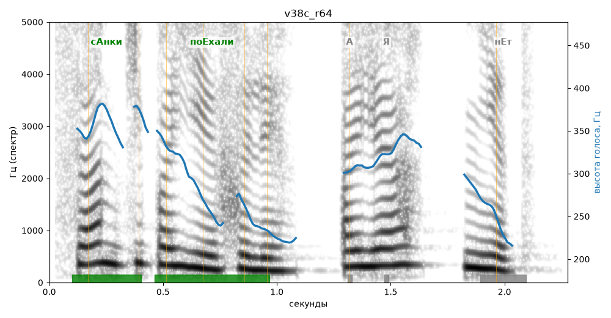

# v38c_r64

Естественность (UTMOS): **2.35 из 5** (живой диктор ≈ 4–4.5)
Эталон: Санки поехали. А я — нет.
Распознано: Санки поехали, а я нет.
Слова: все совпали

## Ударения
(где нужно: ruaccent)

| слово | нужно | у голоса | |
|---|---|---|---|
| санки | сАнки | сАнки | ✓ |
| поехали | поЕхали | поЕхали | ✓ |

## Интонация
- ✓ «санки поехали.» — конец фразы понижается — звучит законченно
- Диапазон голоса 9.1 полутонов (живо), средняя высота 306 Гц

## Паузы и темп
- паузы на своих местах
- Темп 6.4 слога/с (нормально)

_Синяя линия — высота голоса. Над словами заглавная буква — где ударение должно быть; красным — голос поставил не туда (уверенно), оранжевым — возможно._
