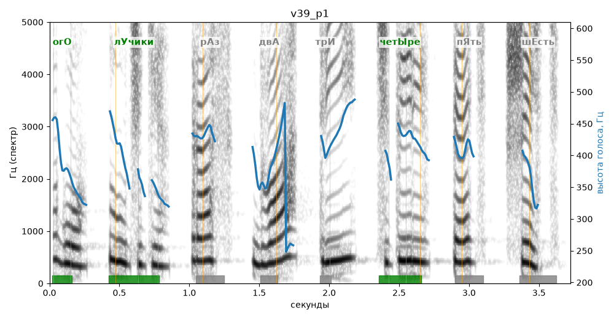

# v39_p1

Естественность (UTMOS): **1.36 из 5** (живой диктор ≈ 4–4.5)
Эталон: Ого! Лучики! Раз, два, три, четыре, пять, шесть!
Распознано: Уго, лучики! Раз, два, три, четыре, пять, шесть!
Расхождения в словах: «ого» → «уго»

## Ударения
(где нужно: ruaccent)

| слово | нужно | у голоса | |
|---|---|---|---|
| ого | огО | огО | ✓ |
| лучики | лУчики | лУчики | ✓ |
| четыре | четЫре | четЫре | ✓ |

## Интонация
- ✓ «лучики!» — выделено слово «лучики» (+2.8 пт)
- ✗ «раз два три четыре пять шесть!» — восклицание звучит ровно, без эмоции
- Диапазон голоса 6.5 полутонов (нормально), средняя высота 403 Гц

## Паузы и темп
- паузы на своих местах
- Темп 7.8 слога/с (быстро)

_Синяя линия — высота голоса. Над словами заглавная буква — где ударение должно быть; красным — голос поставил не туда (уверенно), оранжевым — возможно._
