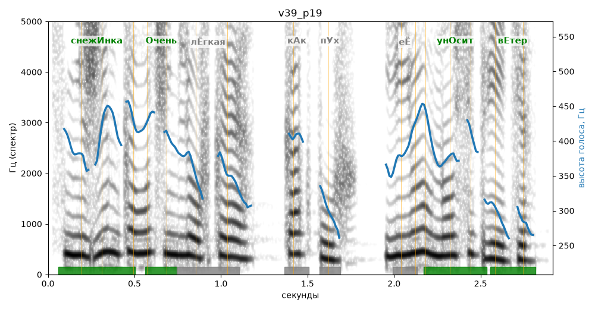

# v39_p19

Естественность (UTMOS): **1.42 из 5** (живой диктор ≈ 4–4.5)
Эталон: Снежинка очень лёгкая, как пух. Её уносит ветер.
Распознано: Снежинка очень лёгкая, как пух, её вносит ветер.
Расхождения в словах: «уносит» → «вносит»

## Ударения
(где нужно: ruaccent)

| слово | нужно | у голоса | |
|---|---|---|---|
| снежинка | снежИнка | снежИнка | ✓ |
| очень | Очень | Очень | ✓ |
| лёгкая | лЁгкая | — | ? |
| её | еЁ | Её | ? не разобрать |
| уносит | унОсит | унОсит | ✓ |
| ветер | вЕтер | вЕтер | ✓ |

## Интонация
- ✓ «снежинка очень лёгкая как пух.» — конец фразы понижается — звучит законченно
- ✓ «её уносит ветер.» — конец фразы понижается — звучит законченно
- Диапазон голоса 8.2 полутонов (живо), средняя высота 380 Гц

## Паузы и темп
- паузы на своих местах
- Темп 7.3 слога/с (быстро)

_Синяя линия — высота голоса. Над словами заглавная буква — где ударение должно быть; красным — голос поставил не туда (уверенно), оранжевым — возможно._
