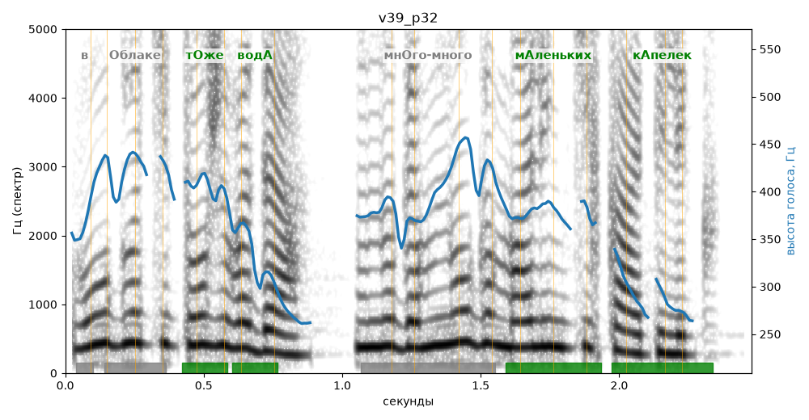

# v39_p32

Естественность (UTMOS): **1.43 из 5** (живой диктор ≈ 4–4.5)
Эталон: В облаке тоже вода. Много-много маленьких капелек.
Распознано: В области тоже вода, но до многом маленьких капелек.
Расхождения в словах: «облаке» → «области»; «много-много» → «но до многом»

## Ударения
(где нужно: ruaccent)

| слово | нужно | у голоса | |
|---|---|---|---|
| облаке | Облаке | облАке | ? не разобрать |
| тоже | тОже | тОже | ✓ |
| вода | водА | водА | ✓ |
| много-много | мнОго-много | много-мнОго | ? не разобрать |
| маленьких | мАленьких | мАленьких | ✓ |
| капелек | кАпелек | кАпелек | ✓ |

## Интонация
- ✓ «в облаке тоже вода.» — конец фразы понижается — звучит законченно
- ✓ «много-много маленьких капелек.» — конец фразы понижается — звучит законченно
- Диапазон голоса 8.5 полутонов (живо), средняя высота 377 Гц

## Паузы и темп
- паузы на своих местах
- Темп 9.0 слога/с (быстро)

_Синяя линия — высота голоса. Над словами заглавная буква — где ударение должно быть; красным — голос поставил не туда (уверенно), оранжевым — возможно._
