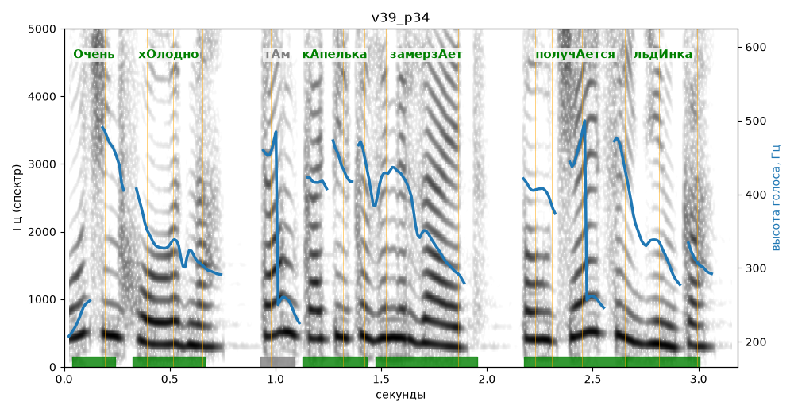

# v39_p34

Естественность (UTMOS): **1.6 из 5** (живой диктор ≈ 4–4.5)
Эталон: Очень холодно. Там капелька замерзает. Получается льдинка.
Распознано: Очень холодно, там капелька замерзает, получается лединка.
Расхождения в словах: «льдинка» → «лединка»

## Ударения
(где нужно: ruaccent)

| слово | нужно | у голоса | |
|---|---|---|---|
| очень | Очень | Очень | ✓ |
| холодно | хОлодно | хОлодно | ✓ |
| капелька | кАпелька | кАпелька | ✓ |
| замерзает | замерзАет | замерзАет | ✓ |
| получается | получАется | получАется | ✓ |
| льдинка | льдИнка | льдИнка | ✓ |

## Интонация
- ✗ «очень холодно.» — конец фразы не понижается — звучит незаконченно / как перечисление
- ✓ «там капелька замерзает.» — конец фразы понижается — звучит законченно
- ✓ «получается льдинка.» — конец фразы понижается — звучит законченно
- Диапазон голоса 11.2 полутонов (живо), средняя высота 344 Гц

## Паузы и темп
- паузы на своих местах
- Темп 8.1 слога/с (быстро)

_Синяя линия — высота голоса. Над словами заглавная буква — где ударение должно быть; красным — голос поставил не туда (уверенно), оранжевым — возможно._
