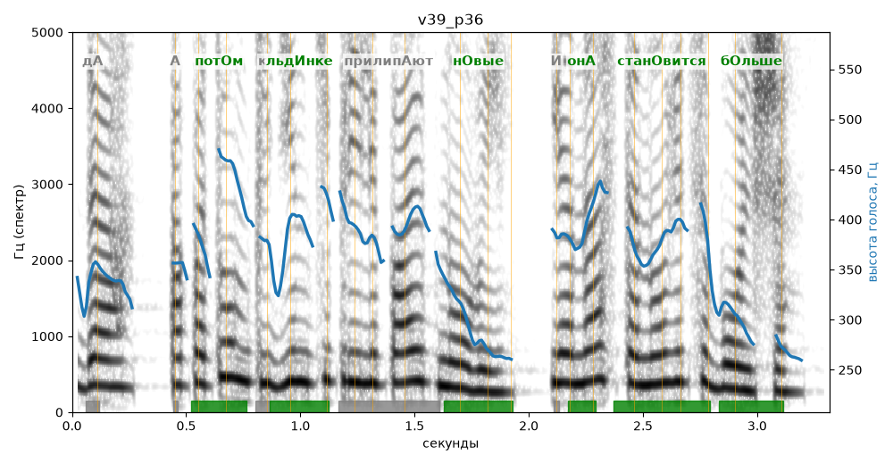

# v39_p36

Естественность (UTMOS): **1.72 из 5** (живой диктор ≈ 4–4.5)
Эталон: Да. А потом к льдинке прилипают новые. И она становится больше.
Распознано: Да, а потом при динке прилипают новые, и она становится больше.
Расхождения в словах: «к льдинке» → «при динке»

## Ударения
(где нужно: ruaccent)

| слово | нужно | у голоса | |
|---|---|---|---|
| потом | потОм | потОм | ✓ |
| льдинке | льдИнке | льдИнке | ✓ |
| прилипают | прилипАют | — | ? |
| новые | нОвые | нОвые | ✓ |
| она | онА | онА | ✓ |
| становится | станОвится | станОвится | ✓ |
| больше | бОльше | бОльше | ✓ |

## Интонация
- ✓ «а потом к льдинке прилипают новые.» — конец фразы понижается — звучит законченно
- ✓ «и она становится больше.» — конец фразы понижается — звучит законченно
- Диапазон голоса 8.5 полутонов (живо), средняя высота 370 Гц

## Паузы и темп
- после «новые.» пауза всего 0.18 с — фразы слипаются
- Темп 8.6 слога/с (быстро)

_Синяя линия — высота голоса. Над словами заглавная буква — где ударение должно быть; красным — голос поставил не туда (уверенно), оранжевым — возможно._
