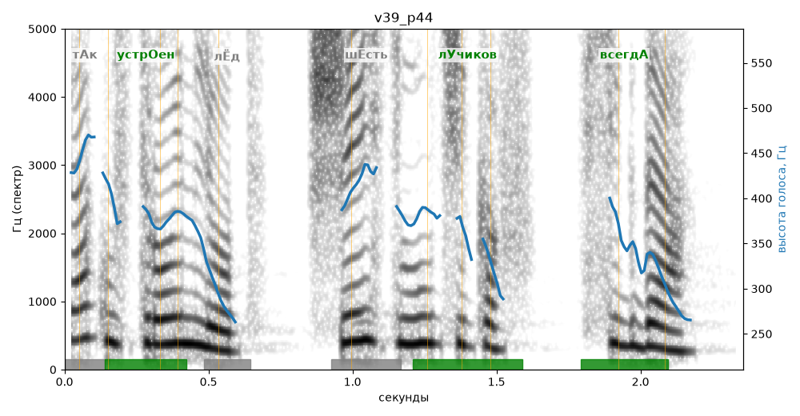

# v39_p44

Естественность (UTMOS): **1.99 из 5** (живой диктор ≈ 4–4.5)
Эталон: Так устроен лёд. Шесть лучиков — всегда!
Распознано: Так устроим лед, шесть лучиков, всегда!
Расхождения в словах: «устроен» → «устроим»

## Ударения
(где нужно: ruaccent)

| слово | нужно | у голоса | |
|---|---|---|---|
| устроен | устрОен | устрОен | ✓ |
| лучиков | лУчиков | лУчиков | ✓ |
| всегда | всегдА | всегдА | ✓ |

## Интонация
- ✓ «так устроен лёд.» — конец фразы понижается — звучит законченно
- ✓ «шесть лучиков всегда!» — выделено слово «шесть» (+2.8 пт)
- Диапазон голоса 8.2 полутонов (живо), средняя высота 372 Гц

## Паузы и темп
- паузы на своих местах
- Темп 6.8 слога/с (быстро)

_Синяя линия — высота голоса. Над словами заглавная буква — где ударение должно быть; красным — голос поставил не туда (уверенно), оранжевым — возможно._
