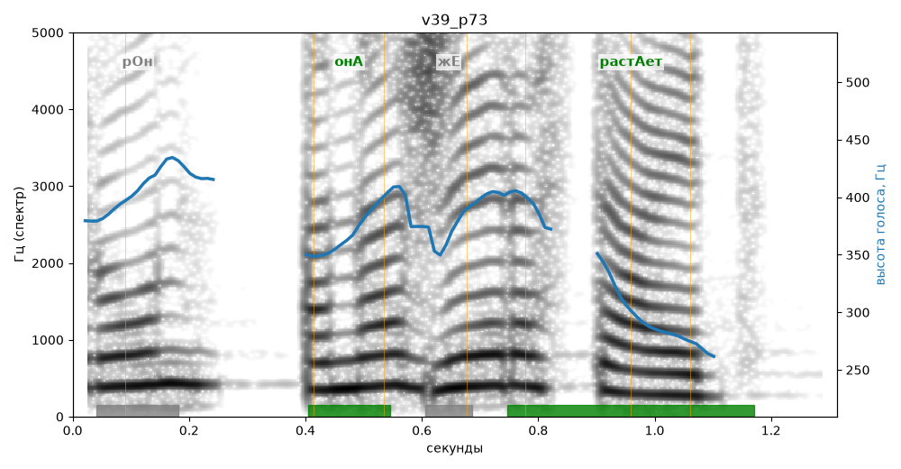

# v39_p73

Естественность (UTMOS): **1.72 из 5** (живой диктор ≈ 4–4.5)
Эталон: Рон, она же растает…
Распознано: Рун, она же растает!
Расхождения в словах: «рон» → «рун»

## Ударения
(где нужно: ruaccent)

| слово | нужно | у голоса | |
|---|---|---|---|
| она | онА | онА | ✓ |
| растает | растАет | растАет | ✓ |

## Интонация
- ✓ «рон она же растает…» — конец фразы понижается — звучит законченно
- Диапазон голоса 7.5 полутонов (живо), средняя высота 379 Гц

## Паузы и темп
- паузы на своих местах
- Темп 7.7 слога/с (быстро)

_Синяя линия — высота голоса. Над словами заглавная буква — где ударение должно быть; красным — голос поставил не туда (уверенно), оранжевым — возможно._
