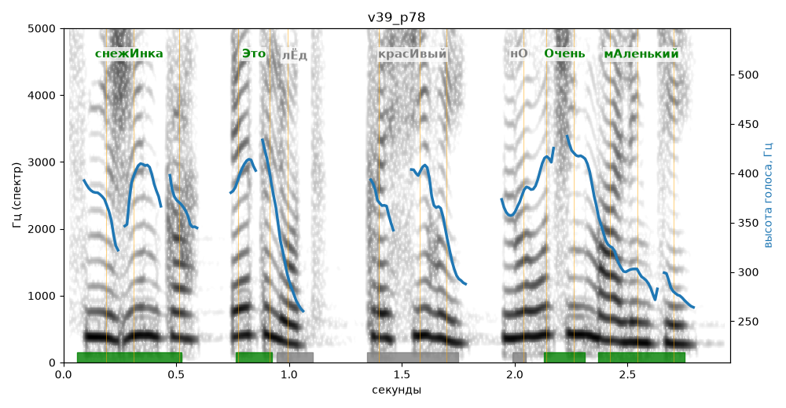

# v39_p78

Естественность (UTMOS): **1.51 из 5** (живой диктор ≈ 4–4.5)
Эталон: Снежинка — это лёд. Красивый, но очень маленький.
Распознано: Снежинка, это лед, красивый, но очень маленький.
Слова: все совпали

## Ударения
(где нужно: ruaccent)

| слово | нужно | у голоса | |
|---|---|---|---|
| снежинка | снежИнка | снежИнка | ✓ |
| это | Это | Это | ✓ |
| красивый | красИвый | крАсивый | ? не разобрать |
| очень | Очень | Очень | ✓ |
| маленький | мАленький | мАленький | ✓ |

## Интонация
- ✓ «снежинка это лёд.» — конец фразы понижается — звучит законченно
- ✓ «красивый но очень маленький.» — конец фразы понижается — звучит законченно
- Диапазон голоса 7.3 полутонов (живо), средняя высота 367 Гц

## Паузы и темп
- паузы на своих местах
- Темп 7.6 слога/с (быстро)

_Синяя линия — высота голоса. Над словами заглавная буква — где ударение должно быть; красным — голос поставил не туда (уверенно), оранжевым — возможно._
