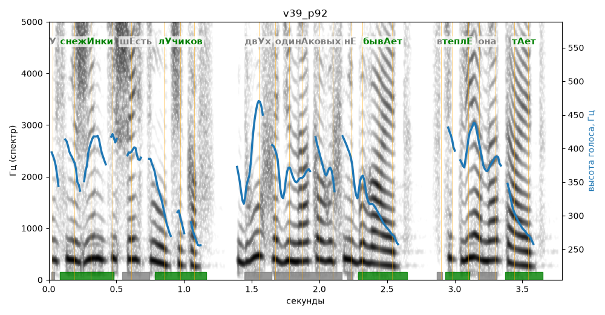

# v39_p92

Естественность (UTMOS): **1.48 из 5** (живой диктор ≈ 4–4.5)
Эталон: У снежинки шесть лучиков. Двух одинаковых не бывает. В тепле она тает.
Распознано: Усь нижнимти 6 лучиков. Двух одинаковых не бывает. В тепле она тает.
Расхождения в словах: «у снежинки шесть» → «усь нижнимти 6»

## Ударения
(где нужно: ruaccent)

| слово | нужно | у голоса | |
|---|---|---|---|
| снежинки | снежИнки | снежИнки | ✓ |
| лучиков | лУчиков | лУчиков | ✓ |
| одинаковых | одинАковых | одИнаковых | ? не разобрать |
| бывает | бывАет | бывАет | ✓ |
| тепле | теплЕ | теплЕ | ✓ |
| она | она | Она | нет эталона |
| тает | тАет | тАет | ✓ |

## Интонация
- ✓ «у снежинки шесть лучиков.» — конец фразы понижается — звучит законченно
- ✓ «двух одинаковых не бывает.» — конец фразы понижается — звучит законченно
- ✓ «в тепле она тает.» — конец фразы понижается — звучит законченно
- Диапазон голоса 8.0 полутонов (живо), средняя высота 366 Гц

## Паузы и темп
- паузы на своих местах
- Темп 8.0 слога/с (быстро)

_Синяя линия — высота голоса. Над словами заглавная буква — где ударение должно быть; красным — голос поставил не туда (уверенно), оранжевым — возможно._
