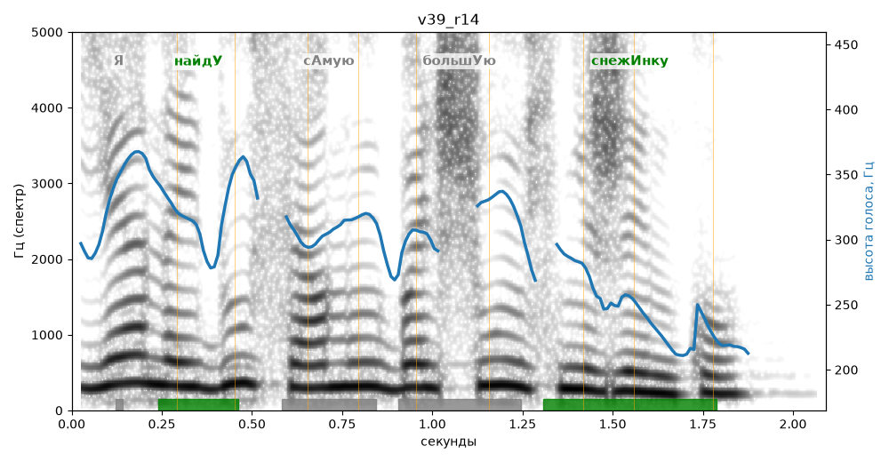

# v39_r14

Естественность (UTMOS): **2.78 из 5** (живой диктор ≈ 4–4.5)
Эталон: Я найду самую большую снежинку!
Распознано: Я найду самую большую снежинку.
Слова: все совпали

## Ударения
(где нужно: ruaccent)

| слово | нужно | у голоса | |
|---|---|---|---|
| найду | найдУ | найдУ | ✓ |
| самую | сАмую | — | ? |
| большую | большУю | — | ? |
| снежинку | снежИнку | снежИнку | ✓ |

## Интонация
- ✓ «я найду самую большую снежинку!» — выделено слово «найду» (+2.0 пт)
- Диапазон голоса 8.8 полутонов (живо), средняя высота 298 Гц

## Паузы и темп
- паузы на своих местах
- Темп 5.4 слога/с (нормально)

_Синяя линия — высота голоса. Над словами заглавная буква — где ударение должно быть; красным — голос поставил не туда (уверенно), оранжевым — возможно._
