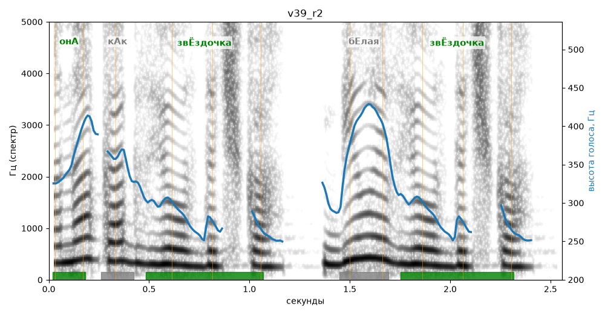

# v39_r2

Естественность (UTMOS): **2.34 из 5** (живой диктор ≈ 4–4.5)
Эталон: Она как звёздочка! Белая звёздочка!
Распознано: Она как звёздочка, белая звёздочка.
Слова: все совпали

## Ударения
(где нужно: ruaccent)

| слово | нужно | у голоса | |
|---|---|---|---|
| она | онА | онА | ✓ |
| звёздочка | звЁздочка | звЁздочка | ✓ |
| белая | бЕлая | — | ? |
| звёздочка | звЁздочка | звЁздочка | ✓ |

## Интонация
- ✓ «она как звёздочка!» — выделено слово «она» (+3.8 пт)
- ✓ «белая звёздочка!» — выделено слово «белая» (+2.8 пт)
- Диапазон голоса 8.6 полутонов (живо), средняя высота 301 Гц

## Паузы и темп
- паузы на своих местах
- Темп 5.8 слога/с (нормально)

_Синяя линия — высота голоса. Над словами заглавная буква — где ударение должно быть; красным — голос поставил не туда (уверенно), оранжевым — возможно._
